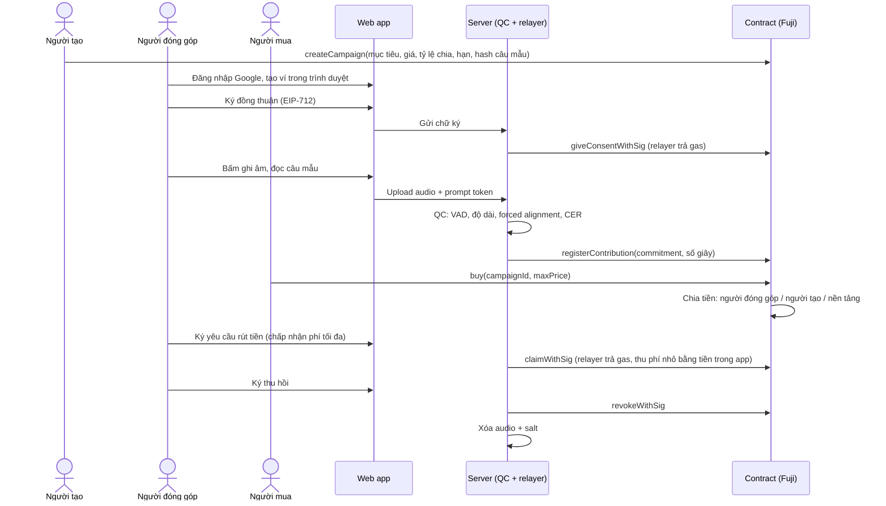
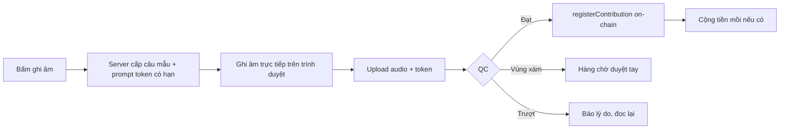
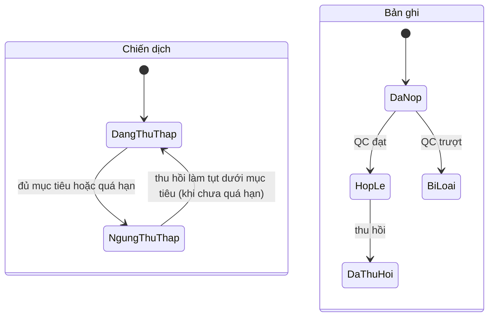
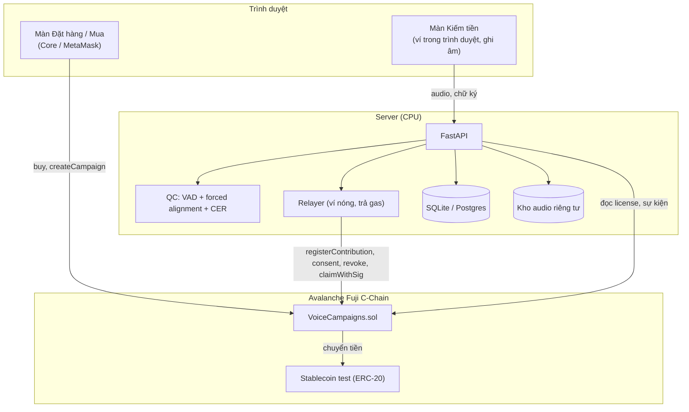

# DatasetMarketplace: Chợ dữ liệu giọng nói tiếng Việt có đồng thuận, chia doanh thu trên Avalanche

> Tài liệu đề xuất dự án cho **Team1 Vietnam UniHack 2026** (2–30/11/2026, hạn nộp **23:59 ngày 21/11/2026**, giờ Việt Nam).
> Tên sản phẩm: **DatasetMarketplace**.

---

## Mục lục

1. [Tóm tắt](#1-tóm-tắt)
2. [Bối cảnh cuộc thi và cách dự án ăn điểm](#2-bối-cảnh-cuộc-thi-và-cách-dự-án-ăn-điểm)
3. [Vấn đề](#3-vấn-đề)
4. [Giải pháp](#4-giải-pháp)
5. [Người dùng và vai trò](#5-người-dùng-và-vai-trò)
6. [Nghiệp vụ chi tiết](#6-nghiệp-vụ-chi-tiết)
7. [Lý thuyết nền tảng](#7-lý-thuyết-nền-tảng)
8. [Kiến trúc hệ thống và công nghệ](#8-kiến-trúc-hệ-thống-và-công-nghệ)
9. [Thiết kế smart contract](#9-thiết-kế-smart-contract)
10. [Thiết kế dịch vụ kiểm tra chất lượng (QC)](#10-thiết-kế-dịch-vụ-kiểm-tra-chất-lượng-qc)
11. [Backend API](#11-backend-api)
12. [Môi trường: test và deploy](#12-môi-trường-test-và-deploy)
13. [Kế hoạch triển khai](#13-kế-hoạch-triển-khai)
14. [Kịch bản demo và pitch](#14-kịch-bản-demo-và-pitch)
15. [Rủi ro và cách xử lý](#15-rủi-ro-và-cách-xử-lý)
16. [Lộ trình sau hackathon](#16-lộ-trình-sau-hackathon)
17. [Checklist nộp bài](#17-checklist-nộp-bài)

---

## 1. Tóm tắt

**Một câu:** Bên cần dữ liệu đặt hàng một dataset giọng nói, người bình thường đọc câu mẫu để kiếm tiền, và mỗi lần dataset được bán, tiền tự chia lại cho những người có giọng trong đó, minh bạch trên Avalanche.

**Ba điểm khác biệt:**

| Điểm | Ý nghĩa |
|---|---|
| **Mua sớm, giá rẻ** | Dataset bán được ngay khi đang thu thập, giá tăng theo tiến độ. Người mua sớm tài trợ cho việc thu thập |
| **Chia doanh thu tự động** | Mỗi lần bán, contract chia tiền cho người đóng góp theo số giây giọng nói hợp lệ |
| **Đồng thuận và thu hồi on-chain** | Người đóng góp ký đồng thuận, có thể rút lại bất cứ lúc nào. Rút lại thì ngừng nhận tiền tương lai, dữ liệu bị xóa khỏi các bản phát hành sau |

**Tiền trong app:** người dùng **chỉ thấy VNĐ** và chỉ dùng **một loại tiền**. Bên dưới, contract lưu bằng USDC (trên Fuji là `mUSDC` giả lập); AVAX chỉ dùng để trả gas ở hậu trường (xem mục 8.4).

**Track:** Social finance (chính), có yếu tố Agent economy/AI.

---

## 2. Bối cảnh cuộc thi và cách dự án ăn điểm

### Yêu cầu nộp bài

- dApp chạy trên L1 riêng, **Fuji testnet** hoặc C-Chain mainnet. Dự án này dùng **Fuji C-Chain**.
- Repo GitHub có README (public, hoặc private nhưng add `tuantqse90`).
- Slide (Canva/Google Slides), video demo 2–3 phút.
- Nộp trên **team1vn.xyz**, không phải Builder Hub.

### Thang điểm và chiến lược

| Tiêu chí | Điểm | Dự án đáp ứng thế nào |
|---|---|---|
| Technical implementation | 25 | Contract chia doanh thu dạng tích lũy (O(1) gas), chữ ký EIP-712 không tốn gas, QC bằng forced alignment wav2vec2 |
| Avalanche integration | 25 | Toàn bộ tiền, giá, đồng thuận, license nằm trong contract của đội trên Fuji. Mỗi thao tác chính là một giao dịch thật, final khoảng 1 giây |
| Creativity & innovation | 15 | Gọi vốn cộng đồng cho dataset + quyền thu hồi đồng thuận có hệ quả kinh tế |
| Impact & use case | 15 | Thiếu dữ liệu giọng vùng miền tiếng Việt; người đóng góp có thu nhập; quyền dữ liệu cá nhân |
| Presentation & pitching | 10 | Câu chuyện hai phía rõ ràng, ví dụ có số liệu |
| UI/UX & demo | 10 | Hai giao diện tách biệt: "Kiếm tiền bằng giọng nói" và "Đặt hàng / Mua dataset" |

---

## 3. Vấn đề

1. **Thiếu dữ liệu giọng tiếng Việt, đặc biệt giọng vùng miền.** Các mô hình ASR thường nhận dạng giọng miền Trung, miền Tây kém hơn giọng chuẩn vì dữ liệu huấn luyện ít.
2. **Thu thập dữ liệu thiếu bằng chứng đồng thuận.** Bên dùng dữ liệu khó chứng minh dữ liệu được thu thập hợp pháp; người cho giọng không biết dữ liệu của mình đi đâu.
3. **Người cho giọng gần như không được hưởng lợi lâu dài.** Thường chỉ được trả một lần (hoặc không gì cả), dù dataset được bán nhiều lần.
4. **Bài toán con gà và quả trứng.** Chưa có dữ liệu thì không ai trả tiền; chưa có tiền thì không trả được người thu âm.

---

## 4. Giải pháp

### Câu chuyện mẫu

1. **Startup "TổngĐài AI"** cần chatbot hiểu giọng miền Trung. Họ **tạo chiến dịch**: "10 giờ giọng miền Trung, 500 câu về ngân hàng, hạn 30 ngày, giá đầy đủ 26 triệu đồng".
2. **Người miền Trung** vào đọc câu mẫu, ghi âm. Hệ thống tự kiểm tra bản ghi có đọc đúng câu không. Đạt thì ghi nhận lên chain.
3. TổngĐài AI **mua khi mới 40%** với giá thấp hơn, được nhận mọi bản cập nhật đến khi đủ 10 giờ.
4. Một **nhóm nghiên cứu đại học** mua sau. Tiền lại được chia cho người đóng góp.
5. Một người đóng góp **rút đồng thuận**: họ giữ tiền đã kiếm, nhưng không được chia các lần bán sau; bản ghi bị xóa khỏi các bản phát hành sau.

### Nguyên tắc thiết kế

- **Chain giữ tiền, quyền và bằng chứng. Server giữ dữ liệu.** Audio và thông tin cá nhân không bao giờ lên chain.
- **Người đóng góp không cần biết blockchain:** đăng nhập Google, ví tạo sẵn trong trình duyệt, không cần AVAX.
- **Mọi quy tắc tiền bạc nằm trong contract**, ai cũng kiểm tra được.

---

## 5. Người dùng và vai trò

| Vai trò | Là ai | Làm gì trên trang |
|---|---|---|
| **Người tạo chiến dịch** | Startup, công ty, lab, nhóm nghiên cứu | Đặt hàng dataset: mô tả, câu mẫu, mục tiêu, giá, hạn; có thể nạp quỹ mồi |
| **Người đóng góp** | Người bình thường (đông) | Ký đồng thuận, đọc câu, ghi âm, rút tiền, thu hồi |
| **Người mua** | Người làm AI (ít); thường người tạo là người mua đầu tiên | Mua dataset, tải các phiên bản |
| **QC oracle** | Server của đội | Chấm bản ghi, ghi nhận bản ghi đạt lên chain, công bố phiên bản dataset |
| **Nền tảng** | Đội phát triển | Nhận phí nền tảng |

> Về kỹ thuật, một ví có thể đảm nhận nhiều vai trò. Trên thực tế, người đóng góp và người mua là hai nhóm khác nhau.

### Ba loại thời hạn

| Loại | Quy định |
|---|---|
| Hạn thu thập | Do người tạo đặt. Hết hạn **hoặc** đủ mục tiêu thì ngừng nhận bản ghi |
| Thời gian được bán | Không giới hạn. Ngừng thu thập vẫn tiếp tục bán |
| Thời hạn license | Vĩnh viễn, trừ bản ghi bị thu hồi không được dùng cho lần huấn luyện mới |
| Quyền thu hồi của người đóng góp | Không giới hạn, lúc nào cũng rút được |

---

## 6. Nghiệp vụ chi tiết

### 6.1. Tổng quan luồng



### 6.2. Tạo chiến dịch

**Đầu vào:**

| Trường | Ví dụ | Lưu ở |
|---|---|---|
| Tên, mô tả, mục đích, loại license | "Giọng miền Trung - ngân hàng", nghiên cứu | Off-chain (metadata URI) |
| Bộ câu mẫu | 500 câu | Off-chain; **hash** lên chain |
| Điều khoản đồng thuận | Văn bản đồng thuận | Off-chain; **hash** lên chain |
| Mục tiêu | 36.000 giây (10 giờ) | On-chain |
| Giá đầy đủ | Nhập 26.000.000 ₫, app quy đổi thành 1.000 USDC | On-chain (USDC) |
| Tỷ lệ chia | 80% người đóng góp, 10% người tạo, 10% nền tảng | On-chain |
| Hạn thu thập | 30 ngày | On-chain |
| Quỹ mồi (tùy chọn) | 5.200.000 ₫, trả 13.000 ₫/phút (200 USDC, 0,5 USDC/phút) | On-chain (USDC) |

**Quỹ mồi** giải quyết bài toán con gà và quả trứng: những người đóng góp đầu tiên được trả ngay, trước khi có người mua.

### 6.3. Đồng thuận

- Người dùng đọc điều khoản (mục đích sử dụng, license, quyền thu hồi, cách dữ liệu được lưu và xóa).
- Ký thông điệp EIP-712 `Consent(campaignId, contributor, termsHash, nonce, deadline)`.
- Relayer gửi giao dịch, trả gas. Contract lưu thời điểm đồng thuận.
- `termsHash` bảo đảm người dùng đồng ý **đúng bản điều khoản** đã công bố; người tạo không sửa lén được.

### 6.4. Đóng góp giọng nói



- **Câu mẫu chỉ hiện khi bấm ghi âm**, prompt token hết hạn sau khoảng 60 giây: khó chuẩn bị audio giả trước.
- **Chỉ ghi âm trực tiếp**, không cho upload file.
- Mỗi người không đọc lại câu đã đọc.
- Bản ghi đạt: server sinh `salt` ngẫu nhiên, tính `commitment = keccak256(audioBytes ‖ salt)`, gọi `registerContribution`. **Trọng số = số giây hợp lệ** (làm tròn xuống).

### 6.5. Tiến độ và giá

```
tiến_độ = min(1, tổng_giây_hợp_lệ / mục_tiêu_giây)
giá     = giá_đầy_đủ × (0,3 + 0,7 × tiến_độ)
```

| Tiến độ | Giá hiển thị (tỷ giá demo 26.000 ₫/USDC) | On-chain |
|---|---|---|
| 0% | ≈ 7.800.000 ₫ | 300 USDC |
| 25% | ≈ 12.350.000 ₫ | 475 USDC |
| 50% | ≈ 16.900.000 ₫ | 650 USDC |
| 75% | ≈ 21.450.000 ₫ | 825 USDC |
| 100% | ≈ 26.000.000 ₫ | 1.000 USDC |

Giá **cố định bằng USDC trên chain**; số VNĐ hiển thị có dấu "≈" vì đi theo tỷ giá.

- Tiến độ tính trên **bản ghi còn hiệu lực**: thu hồi làm tiến độ và giá giảm.
- Giá do contract tính tại thời điểm mua. Người mua truyền `maxPrice` để không bị trả nhiều hơn dự kiến nếu tiến độ thay đổi ngay trước giao dịch.
- Không bán khi chưa có bản ghi hợp lệ nào.

### 6.6. Mua dataset

1. Người mua xem trang chiến dịch: tiến độ, giá, số người đóng góp, nghe mẫu.
2. `approve` stablecoin rồi gọi `buy(campaignId, maxPrice)`.
3. Contract ghi **license**: thời điểm mua, tiến độ lúc mua, giá đã trả.
4. Quyền lợi: tải bản hiện tại và **mọi bản cập nhật** sau đó.
5. Tải dữ liệu: người mua ký một thông điệp chứng minh sở hữu ví; server kiểm tra license on-chain rồi trả file. **File luôn loại bỏ bản ghi đã thu hồi.**
6. Mỗi phiên bản dataset có **Merkle root** công bố on-chain (`publishSnapshot`), người mua đối chiếu được file nhận về.

### 6.7. Chia doanh thu

- Mỗi lần bán: chia theo tỷ lệ (ví dụ 80/10/10).
- Phần của người đóng góp chia **theo số giây còn hiệu lực tại thời điểm bán**, dùng cơ chế tích lũy (mục 7.4): mỗi lần bán chỉ tốn một phép cộng, dù có bao nhiêu người đóng góp.
- Người đóng góp **sau** một lần bán không được chia tiền lần đó; bù lại, các lần bán sau giá cao hơn.
- **Rút tiền có hai cách:**
  - `claim(campaignId)`: người đóng góp tự gửi giao dịch, **không mất phí**, nhưng phải có AVAX để trả gas.
  - `claimWithSig(...)` (mặc định trong app): người đóng góp **chỉ ký**, relayer gửi giao dịch và trả gas AVAX, rồi **thu lại một khoản phí nhỏ bằng chính tiền trong app** (ví dụ 0,1 USDC ≈ 2.600 ₫). Người dùng ký kèm `maxFee` nên phí không thể bị tăng sau khi ký.

### 6.8. Thu hồi đồng thuận

1. Người dùng ký `Revoke(contributionId, nonce, deadline)` (hoặc tự gọi `revoke` nếu có gas).
2. Contract: chốt phần tiền đã kiếm (vẫn rút được), trừ trọng số, ghi `revokedAt`, phát sự kiện `ConsentRevoked`.
3. Tiến độ giảm, giá giảm.
4. Server xóa audio và salt. Hash trên chain không còn liên kết được với giọng nói nào.
5. Phiên bản dataset tiếp theo không còn bản ghi này.
6. License quy định: người mua không dùng bản ghi đã thu hồi cho **lần huấn luyện mới** sau thời điểm thu hồi. Thu hồi không hồi tố với mô hình đã huấn luyện.

**Câu trả lời cho câu hỏi "rút tiền rồi mới thu hồi thì sao?":** người đóng góp giữ tiền đã nhận, nhưng mất toàn bộ thu nhập tương lai từ bản ghi đó. Không cần cơ chế đòi tiền.

**Câu trả lời cho câu hỏi "thu hồi có xóa block không?":** không. Blockchain chỉ ghi thêm. Thu hồi là một giao dịch mới đổi trạng thái. Lịch sử "đồng ý lúc X, thu hồi lúc Y" là bằng chứng kiểm toán cho cả hai phía.

### 6.9. Kết thúc chiến dịch

| Trường hợp | Xử lý |
|---|---|
| Đạt mục tiêu | Ngừng nhận bản ghi, vẫn bán, giá theo công thức (100% nếu không ai thu hồi) |
| Quá hạn chưa đạt | Ngừng nhận bản ghi, vẫn bán với giá theo tiến độ. Người mua giữ bản cuối, không hoàn tiền (đã mua rẻ có tính rủi ro). Quỹ mồi còn dư trả lại người tạo |

### 6.10. Trạng thái



### 6.11. Ví dụ có số liệu

Chiến dịch: mục tiêu 10 giờ (36.000 giây), giá đầy đủ 26.000.000 ₫ (1.000 USDC), chia 80/10/10. VNĐ tính theo tỷ giá demo 26.000 ₫/USDC.

| Bước | Sự kiện | Kết quả |
|---|---|---|
| 1 | An góp 2 giờ, Bình góp 3 giờ | Tổng 5 giờ, tiến độ 50% |
| 2 | Lab X mua | Giá = 0,3 + 0,7 × 0,5 = 65% giá đầy đủ = **16.900.000 ₫** (650 USDC). Người đóng góp nhận 13.520.000 ₫: An **5.408.000 ₫**, Bình **8.112.000 ₫**. Người tạo và nền tảng mỗi bên 1.690.000 ₫ |
| 3 | An rút 5.408.000 ₫ về ví rồi thu hồi | Còn 3 giờ, tiến độ 30% |
| 4 | Lab Y mua | Giá = 0,3 + 0,7 × 0,3 = 51% = **13.260.000 ₫** (510 USDC). Người đóng góp nhận 10.608.000 ₫, **toàn bộ về Bình** (tổng 18.720.000 ₫) |
| 5 | Lab X tải lại | Bản mới chỉ còn 3 giờ của Bình |

Ví dụ này được dùng làm test chính của contract (mục 9.4), với số liệu tính bằng USDC.

---

## 7. Lý thuyết nền tảng

### 7.1. Avalanche và C-Chain

- **Đồng thuận họ Snow (Snowman cho chuỗi tuyến tính):** mỗi validator lặp lại việc hỏi ý kiến một nhóm nhỏ validator chọn ngẫu nhiên; khi đủ nhiều vòng liên tiếp đạt đa số, giao dịch được coi là **final**, không đảo ngược. Kết quả thực tế: finality khoảng **1 giây**, phù hợp với thao tác người dùng phải chờ trên màn hình (nhận tiền ngay khi bản ghi đạt).
- **C-Chain tương thích EVM:** viết Solidity, dùng Foundry/Hardhat, ví MetaMask/Core như Ethereum.
- **Fuji** là testnet; AVAX test lấy từ Core faucet (coupon theo hướng dẫn của ban tổ chức).
- **L1 riêng** (trước gọi là Subnet): chain có luật và token gas riêng. Không dùng trong MVP, đưa vào lộ trình (mục 16).

### 7.2. Chữ ký EIP-712 và relayer (giao dịch không tốn gas cho người dùng)

- **EIP-712** chuẩn hóa việc ký dữ liệu có cấu trúc: ví hiển thị rõ người dùng đang ký gì (chiến dịch nào, điều khoản nào), và chữ ký gắn với đúng contract, đúng chain (domain separator) nên không dùng lại được ở nơi khác.
- **Nonce** chống phát lại chữ ký; **deadline** giới hạn thời gian hiệu lực.
- **Relayer:** server nhận chữ ký, tự gửi giao dịch và trả gas. Contract dùng `ecrecover` để xác minh đúng người dùng đã ký. Người dùng không cần AVAX.
- Rút tiền qua relayer cũng dùng chữ ký (`Claim(campaignId, contributor, maxFee, nonce, deadline)`), để relayer không tự ý rút hộ và trừ phí khi người dùng chưa yêu cầu.

### 7.3. Cam kết băm có salt (hash commitment)

`commitment = keccak256(audioBytes ‖ salt)` với `salt` 32 byte ngẫu nhiên lưu off-chain.

- **Ràng buộc (binding):** không thể tìm audio khác cho ra cùng commitment, nên chứng minh được bản ghi nào đã đăng ký.
- **Che giấu (hiding):** không có salt thì không đoán được audio từ commitment. Khi thu hồi, xóa audio và salt, commitment trên chain trở thành một chuỗi vô nghĩa.
- Nếu băm trần `keccak256(audio)`, ai có bản audio đều đối chiếu được, nên **bắt buộc có salt**.

### 7.4. Chia doanh thu bằng tích lũy theo đơn vị trọng số

Bài toán: chia số tiền `S` cho hàng nghìn người theo trọng số `w_i` (số giây), không được lặp qua từng người.

Contract giữ một biến tích lũy cho mỗi chiến dịch:

```
Mỗi lần bán:  acc ← acc + S / W        (W = tổng trọng số hợp lệ lúc bán)
Tiền của i:   w_i × (acc_hiện_tại − acc_lúc_i_cập_nhật_lần_cuối)
```

Khi trọng số của một người thay đổi (thêm bản ghi, thu hồi), contract **chốt** phần tiền đến thời điểm đó vào `pending`, rồi đặt lại mốc:

```
pending_i    += w_i × acc / 1e18 − rewardDebt_i
w_i          ← w_i ± Δ
rewardDebt_i  = w_i × acc / 1e18
```

- Chi phí mỗi lần bán: **O(1)**. Chi phí mỗi người: chỉ khi họ thay đổi trọng số hoặc rút tiền.
- `acc` nhân hệ số `1e18` để giữ độ chính xác. Phần lẻ do làm tròn ("bụi") được cộng cho nền tảng để tổng tiền luôn khớp.
- Đây là cùng kỹ thuật các contract staking dùng để chia phần thưởng.

### 7.5. Merkle root cho phiên bản dataset

Mỗi phiên bản dataset là danh sách `(contributionId, commitment, đường dẫn file)`. Xây cây Merkle, công bố root on-chain. Người mua kiểm tra được:
- File mình nhận thuộc đúng phiên bản đã công bố.
- Phiên bản đó không chứa bản ghi đã thu hồi (đối chiếu với sự kiện `ConsentRevoked`).

### 7.6. CTC và forced alignment

- **wav2vec2 + CTC:** mô hình xuất ra, cho mỗi khung thời gian (~20 ms), phân bố xác suất trên các ký tự cộng một ký hiệu **blank**. Một câu có thể ứng với nhiều đường đi (lặp ký tự, chèn blank).
- **Forced alignment:** vì **đã biết câu đúng**, ta không cần "đoán" người dùng nói gì mà dùng thuật toán Viterbi tìm đường đi tốt nhất của **đúng câu đó** qua ma trận xác suất. Kết quả: mỗi ký tự/từ có vị trí thời gian và **điểm tin cậy**.
- Điểm tin cậy thấp ở một đoạn nghĩa là đoạn đó không khớp: đọc sai, bỏ từ, hoặc đọc câu khác.
- Ưu điểm so với ASR tự do: nhẹ hơn, ổn định hơn, không bị ảnh hưởng bởi lỗi chính tả của bộ giải mã.

### 7.7. WER và CER

```
WER = (S + D + I) / N     (tính trên từ)
CER = (S + D + I) / N     (tính trên ký tự)
```

S: thay thế, D: xóa, I: chèn, N: số đơn vị trong câu đúng. Với tiếng Việt, **CER** thường ổn định hơn vì sai một dấu thanh không làm hỏng cả từ. **Chuẩn hóa văn bản** trước khi so (viết thường, bỏ dấu câu, chuẩn Unicode NFC, đổi số thành chữ) là bắt buộc.

### 7.8. VAD và phát hiện giọng giả

- **VAD (Voice Activity Detection),** ví dụ Silero VAD: xác định đoạn nào có giọng nói, loại bản ghi im lặng hoặc toàn tạp âm. Chạy CPU rất nhẹ.
- **Anti-spoofing** (ví dụ AASIST): phân biệt giọng thật với giọng TTS/giả lập. Đưa vào lộ trình; MVP chống TTS bằng quy trình (câu mẫu chỉ hiện khi ghi, prompt token có hạn, chỉ ghi trực tiếp).

### 7.9. Khía cạnh pháp lý (cần kiểm tra lại văn bản hiện hành)

- Việt Nam có quy định về bảo vệ dữ liệu cá nhân (Nghị định 13/2023/NĐ-CP, và Luật Bảo vệ dữ liệu cá nhân có hiệu lực từ 2026). Các nguyên tắc chính liên quan: **đồng thuận rõ ràng, đúng mục đích**, và **quyền rút lại đồng thuận**.
- Giọng nói có thể được xem là dữ liệu sinh trắc học, thuộc nhóm dữ liệu nhạy cảm, nên yêu cầu càng chặt.
- Thiết kế của dự án bám các nguyên tắc này: đồng thuận ký số gắn với hash điều khoản, thu hồi bất cứ lúc nào, dữ liệu xóa thật, chỉ lưu hash trên chain.
- Đây là phần trình bày định hướng, không phải tư vấn pháp lý.

---

## 8. Kiến trúc hệ thống và công nghệ

### 8.1. Sơ đồ



### 8.2. Công nghệ

| Lớp | Công nghệ | Lý do |
|---|---|---|
| Smart contract | Solidity ^0.8.24, OpenZeppelin v5, Foundry | Chuẩn, test nhanh, verify dễ trên Snowtrace |
| Chain | Avalanche Fuji C-Chain | Miễn phí, EVM, finality ~1 giây |
| Tiền trong app | Local/Fuji: `MockUSDC` tự deploy (6 decimals). Mainnet: USDC thật | Testnet tự mint; mainnet có giá trị thật, đổi được ra AVAX |
| Hiển thị VNĐ | Tỷ giá cố định (local/Fuji), nguồn tỷ giá qua HTTP có cache (mainnet) | Người dùng Việt chỉ thấy VNĐ |
| Frontend | Next.js (hoặc Vite + React), viem, wagmi, Tailwind | Hệ sinh thái EVM phổ biến |
| Ví người đóng góp | Ví tạo trong trình duyệt (viem `privateKeyToAccount`), khóa mã hóa bằng mật khẩu | Không cần cài ví, không cần AVAX |
| Ví người mua | Core / MetaMask | Người mua là tổ chức, quen ví |
| Backend | Python, FastAPI, web3.py | Cùng ngôn ngữ với phần AI |
| QC | wav2vec2 tiếng Việt (CTC), torchaudio `forced_align`, Silero VAD, jiwer | Chạy CPU, không cần GPU khi phục vụ |
| ASR hiển thị (tùy chọn) | PhoWhisper (tiny/base) qua faster-whisper int8 | Cho người dùng thấy máy nghe được gì |
| Lưu trữ | Ổ đĩa server hoặc bucket riêng tư; SQLite (MVP) | Đơn giản |
| Đăng nhập | Google OAuth | Mỗi email một ví, chống tạo nhiều tài khoản |
| Hosting | VPS 2–4 vCPU (hoặc Hugging Face Spaces CPU) + Vercel cho frontend | GPU free-tier chỉ dùng để phát triển, không chạy server 24/7 được |

### 8.3. Cấu trúc repo

```
giongque/
├── contracts/                     # Foundry
│   ├── src/VoiceCampaigns.sol     # [DEPLOY] contract chính, deploy ở mọi môi trường
│   ├── src/mocks/MockUSDC.sol     # [CHỈ LOCAL + FUJI] token giả lập, cấm lên mainnet
│   ├── test/VoiceCampaigns.t.sol  # [TEST] chạy trên EVM giả lập, không cần mạng
│   ├── script/Deploy.s.sol        # [DEPLOY] tự rẽ nhánh theo chain id
│   ├── script/SeedDemo.s.sol      # [CHỈ LOCAL + FUJI] dữ liệu demo, từ chối mainnet
│   ├── foundry.toml               # rpc_endpoints: local / fuji / mainnet
│   └── .env.example
├── backend/                       # FastAPI
│   ├── app/config.py              # hồ sơ môi trường: local / fuji / mainnet
│   ├── app/money.py               # quy đổi USDC <-> VNĐ
│   ├── app/qc.py
│   ├── app/relayer.py
│   ├── app/main.py
│   ├── tests/                     # [TEST] pytest, chạy với NETWORK=local
│   ├── .env.local.example
│   ├── .env.fuji.example
│   └── requirements.txt
├── frontend/                      # Next.js
│   ├── lib/money.ts               # hiển thị VNĐ
│   ├── app/earn/                  # Màn Kiếm tiền
│   ├── app/buy/                   # Màn Đặt hàng / Mua
│   └── .env.local / .env.fuji
├── docs/
│   ├── architecture.md
│   └── consent-terms.md
└── README.md                  # Làm gì, chạy thế nào, địa chỉ contract
```

### 8.4. Tiền tệ trong hệ thống và hiển thị VNĐ

**Người dùng chỉ thấy VNĐ.** Bên dưới có hai loại tiền, mỗi loại một việc:

| Loại | Vai trò | Ai thấy | Local | Fuji (lúc thi) | Mainnet |
|---|---|---|---|---|---|
| **USDC** (lớp lưu trữ của "tiền trong app") | Mọi khoản có giá trị: giá mua, chia doanh thu, quỹ mồi, phí rút hộ | Người dùng thấy dưới dạng **VNĐ** | `MockUSDC`, tự mint | `MockUSDC`, tự mint | USDC thật |
| **AVAX** | **Chỉ trả gas** cho validator | Người dùng không thấy | Có sẵn trên Anvil | Đội xin từ **Core faucet** | Mua bằng tiền thật |

**Vì sao không lưu thẳng VNĐ trên chain?** Không có stablecoin VNĐ phổ biến để dùng trên mainnet. Lưu bằng USDC thì contract **không phải sửa** khi lên mainnet, chỉ đổi địa chỉ token.

**Quy tắc hiển thị:**
- Người tạo nhập giá bằng **VNĐ**, app quy đổi sang USDC theo tỷ giá lúc tạo và ghi lên chain. Từ đó **giá cố định bằng USDC**.
- Mọi số tiền hiển thị bằng VNĐ có dấu "≈", kèm dòng phụ nhỏ "650 USDC trên Avalanche" để minh bạch.
- **Tỷ giá:** local và Fuji dùng **tỷ giá cố định cấu hình được** (mặc định 26.000 ₫/USDC, chỉ là giả định cho demo); mainnet lấy tỷ giá qua HTTP, cache 5 phút.
- **Phí rút hộ** cũng hiển thị bằng VNĐ: "Phí rút: ≈ 2.600 ₫".

**Vì sao vẫn cần AVAX?** Gas là luật của tầng mạng Avalanche và trả cho validator bằng AVAX; USDC chỉ là một contract ở tầng ứng dụng, mạng không nhận nó làm phí. Token tự mint được thì không có giá trị, nên không thể dùng để trả gas hay đổi ra AVAX. Thiết kế của ta: **relayer trả AVAX ở hậu trường, rồi thu lại phí nhỏ bằng tiền trong app**. Trên mainnet, relayer định kỳ đổi phí USDC thu được sang AVAX trên DEX để tự nạp gas.

**Ai cần AVAX trên Fuji:**

| Ví | Cần AVAX? | Lấy ở đâu |
|---|---|---|
| Ví deploy | Có | Core faucet |
| Ví relayer / QC oracle (có thể dùng chung) | Có | Core faucet |
| Người đóng góp | **Không** (relayer trả hộ) | — |
| Người mua demo / giám khảo | Có, một ít | Ví đội chuyển sẵn qua `SeedDemo.s.sol` |

---

## 9. Thiết kế smart contract

### 9.1. Tổng quan

Contract chính `VoiceCampaigns` (gộp quản lý chiến dịch, đồng thuận, chia doanh thu cho đơn giản khi demo) và token giả lập `MockUSDC` (**chỉ dùng cho local và Fuji**).

| Nhóm | Hàm | Ai gọi | Ai trả gas AVAX |
|---|---|---|---|
| Chiến dịch | `createCampaign`, `withdrawSeed` | Người tạo (Core/MetaMask) | Người tạo |
| Đọc | `isCollecting`, `progressBps`, `currentPrice`, `getCampaign`, `pendingReward` | Ai cũng đọc được | Không tốn gas |
| Đồng thuận | `giveConsent` / `giveConsentWithSig` | Người đóng góp / relayer | Người đóng góp / **relayer** |
| Đóng góp | `registerContribution` | Chỉ QC oracle | QC oracle |
| Thu hồi | `revoke` / `revokeWithSig` | Người đóng góp / relayer | Người đóng góp / **relayer** |
| Mua | `buy(campaignId, maxPrice)` | Người mua | Người mua |
| Rút tiền | `claim` (miễn phí) / `claimWithSig` (trừ phí nhỏ bằng tiền trong app) | Người đóng góp / relayer | Người đóng góp / **relayer** |
| Rút phần chia | `withdraw` | Người tạo, nền tảng, ví nhận phí | Chính họ |
| Phiên bản | `publishSnapshot` | Chỉ QC oracle | QC oracle |
| Quản trị | `setQcOracle`, `setClaimFee` | Owner | Owner |

**Sự kiện:** `CampaignCreated`, `ConsentGiven`, `ContributionRegistered`, `ConsentRevoked`, `Purchased`, `Claimed(amount, fee)`, `ClaimFeeUpdated`, `SnapshotPublished`.

> **Trạng thái kiểm chứng:** contract, test và hai script deploy đã được biên dịch (solc 0.8.28, OpenZeppelin 5.1.0) và chạy bằng Foundry: **7/7 test đạt**; `Deploy.s.sol` và `SeedDemo.s.sol` đã deploy thành công lên chain local (Anvil); chốt chặn mainnet đã được thử và chặn đúng (mục 12.6). Chưa audit bảo mật; chỉ dùng trên testnet.

### 9.2. `src/VoiceCampaigns.sol` — [DEPLOY, mọi môi trường]

```solidity
// SPDX-License-Identifier: MIT
pragma solidity ^0.8.24;

import {IERC20} from "@openzeppelin/contracts/token/ERC20/IERC20.sol";
import {SafeERC20} from "@openzeppelin/contracts/token/ERC20/utils/SafeERC20.sol";
import {Ownable} from "@openzeppelin/contracts/access/Ownable.sol";
import {EIP712} from "@openzeppelin/contracts/utils/cryptography/EIP712.sol";
import {ECDSA} from "@openzeppelin/contracts/utils/cryptography/ECDSA.sol";
import {Nonces} from "@openzeppelin/contracts/utils/Nonces.sol";
import {ReentrancyGuard} from "@openzeppelin/contracts/utils/ReentrancyGuard.sol";

/// @title VoiceCampaigns - chiến dịch thu thập giọng nói, giá theo tiến độ, chia doanh thu, đồng thuận/thu hồi
contract VoiceCampaigns is Ownable, EIP712, Nonces, ReentrancyGuard {
    using SafeERC20 for IERC20;

    uint256 private constant BPS = 10_000;
    uint256 private constant ACC = 1e18;
    uint256 public constant FLOOR_BPS = 3_000; // giá sàn 30%

    bytes32 private constant CONSENT_TYPEHASH = keccak256(
        "Consent(uint256 campaignId,address contributor,bytes32 termsHash,uint256 nonce,uint256 deadline)"
    );
    bytes32 private constant REVOKE_TYPEHASH =
        keccak256("Revoke(uint256 contributionId,uint256 nonce,uint256 deadline)");
    bytes32 private constant CLAIM_TYPEHASH = keccak256(
        "Claim(uint256 campaignId,address contributor,uint256 maxFee,uint256 nonce,uint256 deadline)"
    );

    struct Campaign {
        address creator;
        uint64 deadline;
        uint64 targetSec;
        uint128 fullPrice;
        uint16 contributorBps;
        uint16 creatorBps; // nền tảng nhận phần còn lại
        bytes32 promptSetHash;
        bytes32 termsHash;
        string metadataURI;
        uint256 totalWeight; // tổng số giây hợp lệ
        uint256 accPerWeight; // tích lũy doanh thu / giây, nhân 1e18
        uint256 seedRatePerSec; // tiền mồi trả cho mỗi giây hợp lệ
        uint256 seedBalance;
    }

    struct Contribution {
        uint256 campaignId;
        address contributor;
        bytes32 commitment; // keccak256(audio || salt), salt lưu off-chain
        uint32 durationSec;
        uint64 createdAt;
        uint64 revokedAt; // 0 = còn hiệu lực
    }

    struct Account {
        uint256 weight;
        uint256 rewardDebt;
        uint256 pending;
    }

    struct License {
        uint64 purchasedAt;
        uint16 progressBpsAtPurchase;
        uint128 pricePaid;
    }

    IERC20 public immutable token;
    address public qcOracle;
    uint256 public claimFee; // phí rút hộ qua relayer, tính bằng chính token của app
    address public feeCollector; // ví nhận phí (thường là relayer), dùng để bù tiền gas AVAX

    uint256 public campaignCount;
    uint256 public contributionCount;
    mapping(uint256 => Campaign) internal campaigns;
    mapping(uint256 => Contribution) public contributions;
    mapping(uint256 => mapping(address => Account)) public accounts;
    mapping(uint256 => mapping(address => uint64)) public consentAt;
    mapping(uint256 => mapping(address => License)) public licenses;
    mapping(address => uint256) public withdrawable; // người tạo và nền tảng
    mapping(bytes32 => bool) public usedCommitment;

    event CampaignCreated(uint256 indexed campaignId, address indexed creator, uint64 targetSec, uint128 fullPrice, uint64 deadline);
    event ConsentGiven(uint256 indexed campaignId, address indexed contributor, bytes32 termsHash);
    event ContributionRegistered(uint256 indexed contributionId, uint256 indexed campaignId, address indexed contributor, bytes32 commitment, uint32 durationSec, uint256 seedPaid);
    event ConsentRevoked(uint256 indexed contributionId, uint256 indexed campaignId, address indexed contributor, uint64 revokedAt);
    event Purchased(uint256 indexed campaignId, address indexed buyer, uint256 price, uint16 progressBps);
    event Claimed(uint256 indexed campaignId, address indexed contributor, uint256 amount, uint256 fee);
    event ClaimFeeUpdated(uint256 claimFee, address feeCollector);
    event SnapshotPublished(uint256 indexed campaignId, bytes32 merkleRoot, string uri);
    event QcOracleUpdated(address qcOracle);

    error NotQcOracle();
    error InvalidParams();
    error NotCollecting();
    error NoConsent();
    error AlreadyConsented();
    error DuplicateCommitment();
    error AlreadyRevoked();
    error NotContributor();
    error BadSignature();
    error Expired();
    error AlreadyLicensed();
    error NothingToSell();
    error PriceTooHigh();
    error NotCreator();
    error TooEarly();
    error NothingToClaim();
    error FeeTooHigh();

    modifier onlyQc() {
        if (msg.sender != qcOracle) revert NotQcOracle();
        _;
    }

    constructor(address token_, address qcOracle_, address owner_) Ownable(owner_) EIP712("GiongQue", "1") {
        token = IERC20(token_);
        qcOracle = qcOracle_;
        feeCollector = owner_;
    }

    // ------------------------------------------------------------------ chiến dịch

    function createCampaign(
        uint64 targetSec,
        uint128 fullPrice,
        uint16 contributorBps,
        uint16 creatorBps,
        uint64 deadline,
        bytes32 promptSetHash,
        bytes32 termsHash,
        string calldata metadataURI,
        uint256 seedRatePerSec,
        uint256 seedAmount
    ) external returns (uint256 id) {
        if (targetSec == 0 || fullPrice == 0 || deadline <= block.timestamp) revert InvalidParams();
        if (uint256(contributorBps) + creatorBps > BPS) revert InvalidParams();

        id = campaignCount++;
        Campaign storage c = campaigns[id];
        c.creator = msg.sender;
        c.deadline = deadline;
        c.targetSec = targetSec;
        c.fullPrice = fullPrice;
        c.contributorBps = contributorBps;
        c.creatorBps = creatorBps;
        c.promptSetHash = promptSetHash;
        c.termsHash = termsHash;
        c.metadataURI = metadataURI;
        c.seedRatePerSec = seedRatePerSec;
        if (seedAmount > 0) {
            c.seedBalance = seedAmount;
            token.safeTransferFrom(msg.sender, address(this), seedAmount);
        }
        emit CampaignCreated(id, msg.sender, targetSec, fullPrice, deadline);
    }

    function isCollecting(uint256 campaignId) public view returns (bool) {
        Campaign storage c = campaigns[campaignId];
        return block.timestamp < c.deadline && c.totalWeight < c.targetSec;
    }

    function progressBps(uint256 campaignId) public view returns (uint16) {
        Campaign storage c = campaigns[campaignId];
        uint256 p = c.totalWeight * BPS / c.targetSec;
        return uint16(p > BPS ? BPS : p);
    }

    function currentPrice(uint256 campaignId) public view returns (uint256) {
        Campaign storage c = campaigns[campaignId];
        uint256 p = progressBps(campaignId);
        return uint256(c.fullPrice) * (FLOOR_BPS + (BPS - FLOOR_BPS) * p / BPS) / BPS;
    }

    // ------------------------------------------------------------------ đồng thuận

    function giveConsent(uint256 campaignId) external {
        _consent(campaignId, msg.sender);
    }

    function giveConsentWithSig(uint256 campaignId, address contributor, uint256 deadline, bytes calldata sig) external {
        if (block.timestamp > deadline) revert Expired();
        bytes32 structHash = keccak256(
            abi.encode(CONSENT_TYPEHASH, campaignId, contributor, campaigns[campaignId].termsHash, _useNonce(contributor), deadline)
        );
        if (ECDSA.recover(_hashTypedDataV4(structHash), sig) != contributor) revert BadSignature();
        _consent(campaignId, contributor);
    }

    function _consent(uint256 campaignId, address contributor) internal {
        if (campaignId >= campaignCount) revert InvalidParams();
        if (consentAt[campaignId][contributor] != 0) revert AlreadyConsented();
        consentAt[campaignId][contributor] = uint64(block.timestamp);
        emit ConsentGiven(campaignId, contributor, campaigns[campaignId].termsHash);
    }

    // ------------------------------------------------------------------ đóng góp (chỉ QC oracle)

    function registerContribution(uint256 campaignId, address contributor, bytes32 commitment, uint32 durationSec)
        external
        onlyQc
        returns (uint256 id)
    {
        if (durationSec == 0) revert InvalidParams();
        if (!isCollecting(campaignId)) revert NotCollecting();
        if (consentAt[campaignId][contributor] == 0) revert NoConsent();
        if (usedCommitment[commitment]) revert DuplicateCommitment();
        usedCommitment[commitment] = true;

        Campaign storage c = campaigns[campaignId];
        Account storage a = accounts[campaignId][contributor];
        _settle(c, a);
        a.weight += durationSec;
        c.totalWeight += durationSec;
        a.rewardDebt = a.weight * c.accPerWeight / ACC;

        uint256 seedPaid = uint256(durationSec) * c.seedRatePerSec;
        if (seedPaid > c.seedBalance) seedPaid = c.seedBalance;
        if (seedPaid > 0) {
            c.seedBalance -= seedPaid;
            a.pending += seedPaid;
        }

        id = contributionCount++;
        contributions[id] = Contribution({
            campaignId: campaignId,
            contributor: contributor,
            commitment: commitment,
            durationSec: durationSec,
            createdAt: uint64(block.timestamp),
            revokedAt: 0
        });
        emit ContributionRegistered(id, campaignId, contributor, commitment, durationSec, seedPaid);
    }

    // ------------------------------------------------------------------ thu hồi

    function revoke(uint256 contributionId) external {
        if (contributions[contributionId].contributor != msg.sender) revert NotContributor();
        _revoke(contributionId);
    }

    function revokeWithSig(uint256 contributionId, uint256 deadline, bytes calldata sig) external {
        if (block.timestamp > deadline) revert Expired();
        address contributor = contributions[contributionId].contributor;
        bytes32 structHash = keccak256(abi.encode(REVOKE_TYPEHASH, contributionId, _useNonce(contributor), deadline));
        if (contributor == address(0) || ECDSA.recover(_hashTypedDataV4(structHash), sig) != contributor) {
            revert BadSignature();
        }
        _revoke(contributionId);
    }

    function _revoke(uint256 contributionId) internal {
        Contribution storage r = contributions[contributionId];
        if (r.revokedAt != 0) revert AlreadyRevoked();
        Campaign storage c = campaigns[r.campaignId];
        Account storage a = accounts[r.campaignId][r.contributor];
        _settle(c, a); // tiền đã kiếm được giữ nguyên
        a.weight -= r.durationSec;
        c.totalWeight -= r.durationSec;
        a.rewardDebt = a.weight * c.accPerWeight / ACC;
        r.revokedAt = uint64(block.timestamp);
        emit ConsentRevoked(contributionId, r.campaignId, r.contributor, r.revokedAt);
    }

    // ------------------------------------------------------------------ mua và chia doanh thu

    function buy(uint256 campaignId, uint256 maxPrice) external nonReentrant {
        Campaign storage c = campaigns[campaignId];
        if (c.totalWeight == 0) revert NothingToSell();
        if (licenses[campaignId][msg.sender].purchasedAt != 0) revert AlreadyLicensed();
        uint256 price = currentPrice(campaignId);
        if (price > maxPrice) revert PriceTooHigh();
        uint16 p = progressBps(campaignId);

        token.safeTransferFrom(msg.sender, address(this), price);

        uint256 contributorShare = price * c.contributorBps / BPS;
        uint256 creatorShare = price * c.creatorBps / BPS;
        uint256 accDelta = contributorShare * ACC / c.totalWeight;
        uint256 distributed = accDelta * c.totalWeight / ACC;
        c.accPerWeight += accDelta;

        // phần lẻ do làm tròn được cộng cho nền tảng
        uint256 platformShare = price - creatorShare - distributed;
        withdrawable[c.creator] += creatorShare;
        withdrawable[owner()] += platformShare;

        licenses[campaignId][msg.sender] = License({
            purchasedAt: uint64(block.timestamp),
            progressBpsAtPurchase: p,
            pricePaid: uint128(price)
        });
        emit Purchased(campaignId, msg.sender, price, p);
    }

    function pendingReward(uint256 campaignId, address contributor) external view returns (uint256) {
        Campaign storage c = campaigns[campaignId];
        Account storage a = accounts[campaignId][contributor];
        return a.pending + a.weight * c.accPerWeight / ACC - a.rewardDebt;
    }

    /// @notice Người đóng góp tự rút (tự trả gas bằng AVAX), không mất phí.
    function claim(uint256 campaignId) external nonReentrant {
        _claim(campaignId, msg.sender, 0);
    }

    /// @notice Rút qua relayer: người đóng góp chỉ ký, relayer trả gas AVAX và thu lại
    ///         một khoản phí nhỏ bằng token của app. maxFee bảo vệ người dùng nếu phí bị đổi.
    function claimWithSig(uint256 campaignId, address contributor, uint256 maxFee, uint256 deadline, bytes calldata sig)
        external
        nonReentrant
    {
        if (block.timestamp > deadline) revert Expired();
        uint256 fee = claimFee;
        if (fee > maxFee) revert FeeTooHigh();
        bytes32 structHash =
            keccak256(abi.encode(CLAIM_TYPEHASH, campaignId, contributor, maxFee, _useNonce(contributor), deadline));
        if (ECDSA.recover(_hashTypedDataV4(structHash), sig) != contributor) revert BadSignature();
        _claim(campaignId, contributor, fee);
    }

    function _claim(uint256 campaignId, address contributor, uint256 fee) internal {
        Campaign storage c = campaigns[campaignId];
        Account storage a = accounts[campaignId][contributor];
        _settle(c, a);
        uint256 amount = a.pending;
        if (amount == 0 || amount <= fee) revert NothingToClaim();
        a.pending = 0;
        if (fee > 0) withdrawable[feeCollector] += fee;
        token.safeTransfer(contributor, amount - fee);
        emit Claimed(campaignId, contributor, amount - fee, fee);
    }

    function withdraw() external nonReentrant {
        uint256 amount = withdrawable[msg.sender];
        withdrawable[msg.sender] = 0;
        if (amount > 0) token.safeTransfer(msg.sender, amount);
    }

    function withdrawSeed(uint256 campaignId) external nonReentrant {
        Campaign storage c = campaigns[campaignId];
        if (msg.sender != c.creator) revert NotCreator();
        if (block.timestamp < c.deadline) revert TooEarly();
        uint256 amount = c.seedBalance;
        c.seedBalance = 0;
        if (amount > 0) token.safeTransfer(msg.sender, amount);
    }

    // ------------------------------------------------------------------ phiên bản dataset, quản trị

    function publishSnapshot(uint256 campaignId, bytes32 merkleRoot, string calldata uri) external onlyQc {
        emit SnapshotPublished(campaignId, merkleRoot, uri);
    }

    function setQcOracle(address qcOracle_) external onlyOwner {
        qcOracle = qcOracle_;
        emit QcOracleUpdated(qcOracle_);
    }

    function setClaimFee(uint256 claimFee_, address feeCollector_) external onlyOwner {
        if (feeCollector_ == address(0)) revert InvalidParams();
        claimFee = claimFee_;
        feeCollector = feeCollector_;
        emit ClaimFeeUpdated(claimFee_, feeCollector_);
    }

    function getCampaign(uint256 campaignId) external view returns (Campaign memory) {
        return campaigns[campaignId];
    }

    function nonceOf(address user) external view returns (uint256) {
        return nonces(user);
    }

    // ------------------------------------------------------------------ nội bộ

    function _settle(Campaign storage c, Account storage a) internal {
        uint256 accrued = a.weight * c.accPerWeight / ACC;
        a.pending += accrued - a.rewardDebt;
        a.rewardDebt = accrued;
    }
}
```

### 9.3. `src/mocks/MockUSDC.sol` — [CHỈ LOCAL + FUJI]

```solidity
// SPDX-License-Identifier: MIT
pragma solidity ^0.8.24;

import {ERC20} from "@openzeppelin/contracts/token/ERC20/ERC20.sol";

/// @notice CHỈ DÙNG CHO LOCAL VÀ FUJI. Đóng vai USDC (6 số thập phân), ai cũng mint được.
///         Script deploy từ chối triển khai contract này lên mainnet.
contract MockUSDC is ERC20 {
    constructor() ERC20("Mock USDC", "mUSDC") {}

    function decimals() public pure override returns (uint8) {
        return 6;
    }

    function mint(address to, uint256 amount) external {
        _mint(to, amount);
    }
}
```

### 9.4. `test/VoiceCampaigns.t.sol` — [TEST, không cần mạng]

```solidity
// SPDX-License-Identifier: MIT
pragma solidity ^0.8.24;

// Test chạy trên EVM giả lập của Foundry: KHÔNG cần mạng, KHÔNG cần AVAX.
import {Test} from "forge-std/Test.sol";
import {VoiceCampaigns} from "../src/VoiceCampaigns.sol";
import {MockUSDC} from "../src/mocks/MockUSDC.sol";

contract VoiceCampaignsTest is Test {
    VoiceCampaigns vc;
    MockUSDC usdc;

    address qc = makeAddr("qc");
    address creator = makeAddr("creator");
    address an = makeAddr("an");
    address binh = makeAddr("binh");
    address labX = makeAddr("labX");
    address labY = makeAddr("labY");

    function setUp() public {
        usdc = new MockUSDC();
        vc = new VoiceCampaigns(address(usdc), qc, address(this));
        usdc.mint(labX, 1_000e6);
        usdc.mint(labY, 1_000e6);
        vm.prank(creator);
        vc.createCampaign(
            36_000, 1_000e6, 8_000, 1_000, uint64(block.timestamp + 30 days),
            keccak256("prompts"), keccak256("terms"), "ipfs://meta", 0, 0
        );
    }

    function _buy(address buyer, uint256 maxPrice) internal {
        vm.startPrank(buyer);
        usdc.approve(address(vc), type(uint256).max);
        vc.buy(0, maxPrice);
        vm.stopPrank();
    }

    function _digest(bytes32 structHash) internal view returns (bytes32) {
        bytes32 domainSeparator = keccak256(abi.encode(
            keccak256("EIP712Domain(string name,string version,uint256 chainId,address verifyingContract)"),
            keccak256("GiongQue"), keccak256("1"), block.chainid, address(vc)
        ));
        return keccak256(abi.encodePacked("\x19\x01", domainSeparator, structHash));
    }

    /// Kịch bản mục 6.11: An 2h, Bình 3h -> Lab X mua 650 -> An thu hồi -> Lab Y mua 510
    function test_ScenarioRevenueShareAndRevoke() public {
        vm.prank(an);
        vc.giveConsent(0);
        vm.prank(binh);
        vc.giveConsent(0);

        vm.startPrank(qc);
        uint256 idAn = vc.registerContribution(0, an, keccak256("an-1"), 7_200);
        vc.registerContribution(0, binh, keccak256("binh-1"), 10_800);
        vm.stopPrank();

        assertEq(vc.progressBps(0), 5_000);
        assertEq(vc.currentPrice(0), 650e6);
        _buy(labX, 650e6);

        assertApproxEqAbs(vc.pendingReward(0, an), 208e6, 1);
        assertApproxEqAbs(vc.pendingReward(0, binh), 312e6, 1);
        assertEq(vc.withdrawable(creator), 65e6);

        vm.prank(an);
        vc.claim(0); // tự rút, không mất phí
        assertApproxEqAbs(usdc.balanceOf(an), 208e6, 1);

        vm.prank(an);
        vc.revoke(idAn);
        assertEq(vc.progressBps(0), 3_000);
        assertEq(vc.currentPrice(0), 510e6);

        _buy(labY, 510e6);
        assertEq(vc.pendingReward(0, an), 0);
        assertApproxEqAbs(vc.pendingReward(0, binh), 720e6, 2);

        // Tổng tiền trong contract khớp với nghĩa vụ phải trả
        vm.prank(binh);
        vc.claim(0);
        vm.prank(creator);
        vc.withdraw();
        vc.withdraw(); // nền tảng (owner = test contract)
        assertEq(usdc.balanceOf(address(vc)), 0);
    }

    /// Rút qua relayer: người dùng chỉ ký, relayer trả gas, phí trừ bằng token của app
    function test_ClaimWithSigChargesFeeInAppToken() public {
        (address alice, uint256 pk) = makeAddrAndKey("alice");
        address relayer = makeAddr("relayer");
        vc.setClaimFee(100_000, relayer); // 0,1 mUSDC

        vm.prank(alice);
        vc.giveConsent(0);
        vm.prank(qc);
        vc.registerContribution(0, alice, keccak256("alice-1"), 18_000);
        _buy(labX, 650e6); // alice là người đóng góp duy nhất -> nhận 520

        uint256 deadline = block.timestamp + 1 hours;
        bytes32 h = keccak256(abi.encode(
            keccak256("Claim(uint256 campaignId,address contributor,uint256 maxFee,uint256 nonce,uint256 deadline)"),
            uint256(0), alice, uint256(100_000), uint256(0), deadline
        ));
        (uint8 v, bytes32 r, bytes32 s) = vm.sign(pk, _digest(h));

        vm.prank(relayer); // relayer gửi giao dịch, trả gas AVAX
        vc.claimWithSig(0, alice, 100_000, deadline, abi.encodePacked(r, s, v));

        assertApproxEqAbs(usdc.balanceOf(alice), 520e6 - 100_000, 1);
        assertEq(vc.withdrawable(relayer), 100_000);
    }

    function test_ClaimWithSigRevertsIfFeeRaised() public {
        (address alice, uint256 pk) = makeAddrAndKey("alice");
        vm.prank(alice);
        vc.giveConsent(0);
        vm.prank(qc);
        vc.registerContribution(0, alice, keccak256("alice-1"), 18_000);
        _buy(labX, 650e6);

        vc.setClaimFee(500_000, address(this)); // phí tăng sau khi user đã ký maxFee = 0,1
        uint256 deadline = block.timestamp + 1 hours;
        bytes32 h = keccak256(abi.encode(
            keccak256("Claim(uint256 campaignId,address contributor,uint256 maxFee,uint256 nonce,uint256 deadline)"),
            uint256(0), alice, uint256(100_000), uint256(0), deadline
        ));
        (uint8 v, bytes32 r, bytes32 s) = vm.sign(pk, _digest(h));
        vm.expectRevert(VoiceCampaigns.FeeTooHigh.selector);
        vc.claimWithSig(0, alice, 100_000, deadline, abi.encodePacked(r, s, v));
    }

    function test_ConsentWithSigAndRevokeWithSig() public {
        (address alice, uint256 pk) = makeAddrAndKey("alice");
        uint256 deadline = block.timestamp + 1 hours;

        bytes32 consentHash = keccak256(abi.encode(
            keccak256("Consent(uint256 campaignId,address contributor,bytes32 termsHash,uint256 nonce,uint256 deadline)"),
            uint256(0), alice, keccak256("terms"), uint256(0), deadline
        ));
        (uint8 v, bytes32 r, bytes32 s) = vm.sign(pk, _digest(consentHash));
        vc.giveConsentWithSig(0, alice, deadline, abi.encodePacked(r, s, v)); // relayer gửi
        assertGt(vc.consentAt(0, alice), 0);

        vm.prank(qc);
        uint256 id = vc.registerContribution(0, alice, keccak256("alice-1"), 600);

        bytes32 revokeHash = keccak256(abi.encode(
            keccak256("Revoke(uint256 contributionId,uint256 nonce,uint256 deadline)"), id, uint256(1), deadline
        ));
        (v, r, s) = vm.sign(pk, _digest(revokeHash));
        vc.revokeWithSig(id, deadline, abi.encodePacked(r, s, v));
        (,,,,, uint64 revokedAt) = vc.contributions(id);
        assertGt(revokedAt, 0);
    }

    function test_RevertWithoutConsent() public {
        vm.prank(qc);
        vm.expectRevert(VoiceCampaigns.NoConsent.selector);
        vc.registerContribution(0, an, keccak256("x"), 10);
    }

    function test_RevertDuplicateCommitment() public {
        vm.prank(an);
        vc.giveConsent(0);
        vm.startPrank(qc);
        vc.registerContribution(0, an, keccak256("same"), 10);
        vm.expectRevert(VoiceCampaigns.DuplicateCommitment.selector);
        vc.registerContribution(0, an, keccak256("same"), 10);
        vm.stopPrank();
    }

    function test_RevertPriceTooHigh() public {
        vm.prank(an);
        vc.giveConsent(0);
        vm.prank(qc);
        vc.registerContribution(0, an, keccak256("a"), 18_000);
        vm.startPrank(labX);
        usdc.approve(address(vc), type(uint256).max);
        vm.expectRevert(VoiceCampaigns.PriceTooHigh.selector);
        vc.buy(0, 600e6); // giá thực 650
        vm.stopPrank();
    }
}
```

Kết quả `forge test`:

```
Ran 7 tests for test/VoiceCampaigns.t.sol:VoiceCampaignsTest
[PASS] test_ClaimWithSigChargesFeeInAppToken()
[PASS] test_ClaimWithSigRevertsIfFeeRaised()
[PASS] test_ConsentWithSigAndRevokeWithSig()
[PASS] test_RevertDuplicateCommitment()
[PASS] test_RevertPriceTooHigh()
[PASS] test_RevertWithoutConsent()
[PASS] test_ScenarioRevenueShareAndRevoke()
Suite result: ok. 7 passed; 0 failed; 0 skipped
```

### 9.5. Các quyết định thiết kế và giới hạn

- **QC oracle tập trung:** chỉ server của đội được gọi `registerContribution`. Đây là điểm tin cậy duy nhất, cần nói thẳng khi pitch.
- **Phí rút hộ do owner đặt**, nhưng người dùng luôn ký kèm `maxFee`, và luôn có lựa chọn tự rút miễn phí bằng `claim`.
- **Giá có thể giảm khi có thu hồi.** Có `maxPrice` để bảo vệ người mua.
- **Mỗi ví chỉ mua một license cho mỗi chiến dịch.** Không hoàn tiền khi chiến dịch không đạt mục tiêu.
- **Commitment đã dùng bị khóa vĩnh viễn**, kể cả sau thu hồi.

---

## 10. Thiết kế dịch vụ kiểm tra chất lượng (QC)

### 10.1. Quy trình

| Bước | Kiểm tra | Loại bản ghi khi |
|---|---|---|
| 1 | Độ dài | Ngoài 1,5–15 giây |
| 2 | VAD (Silero) | Dưới 50% thời lượng là giọng nói |
| 3 | Tốc độ đọc | Ngoài 5–30 ký tự/giây giọng nói |
| 4 | Giải mã tham lam → CER | CER cao (đọc sai câu) |
| 5 | Forced alignment với câu mẫu | Điểm tin cậy trung bình thấp, hoặc có từ điểm quá thấp (bỏ từ) |
| 6 | Chống trùng | Trùng commitment / đã đọc câu này |

Kết quả có ba mức: **đạt** (ghi lên chain), **vùng xám** (hàng chờ duyệt tay), **loại** (báo lý do, đọc lại).

### 10.2. Nguyên tắc soạn câu mẫu

- **Viết số bằng chữ** ("hai mươi lăm" thay vì "25") để khỏi phải chuẩn hóa số.
- Dài 6–20 từ, tránh tên riêng hiếm và từ nước ngoài.
- Kiểm tra mọi ký tự có trong vocab của model (hàm `_targets` báo ký tự ngoài vocab).

### 10.3. `backend/app/qc.py` — [DEPLOY, chạy CPU]

> **Trạng thái kiểm chứng:** đã qua kiểm tra cú pháp; hàm chuẩn hóa và CER đã chạy thử. **Chưa chạy với model thật** (môi trường soạn tài liệu không tải được model từ Hugging Face). Trước khi dùng cần kiểm tra vocab của model, đo độ trễ trên CPU và chọn lại ngưỡng (mục 10.4).

```python
"""QC cho bản ghi giọng nói: VAD + forced alignment (wav2vec2 CTC) + CER. Chạy CPU.

Yêu cầu (ghim phiên bản vì torchaudio đang dần bỏ một số API):
    torch==2.5.1 torchaudio==2.5.1 transformers>=4.44 silero-vad>=5.1 jiwer>=3.0 soundfile
"""
from __future__ import annotations

import re
import unicodedata
from dataclasses import dataclass, field

import jiwer
import torch
import torchaudio
import torchaudio.functional as AF
from silero_vad import get_speech_timestamps, load_silero_vad
from transformers import Wav2Vec2ForCTC, Wav2Vec2Processor

SR = 16_000
MODEL_ID = "nguyenvulebinh/wav2vec2-base-vietnamese-250h"  # kiểm tra vocab trước khi dùng


@dataclass
class Thresholds:
    min_sec: float = 1.5
    max_sec: float = 15.0
    min_speech_ratio: float = 0.5
    min_chars_per_sec: float = 5.0
    max_chars_per_sec: float = 30.0
    max_cer_pass: float = 0.15      # dưới mức này: đạt
    max_cer_gray: float = 0.30      # giữa hai mức: vùng xám, duyệt tay
    min_align_pass: float = 0.60    # điểm alignment trung bình
    min_align_gray: float = 0.40
    min_word_score: float = 0.20    # một từ quá thấp => nghi bỏ từ / đọc sai


@dataclass
class QCResult:
    decision: str                   # "pass" | "gray" | "reject"
    reasons: list[str] = field(default_factory=list)
    duration_sec: float = 0.0
    speech_sec: float = 0.0
    cer: float | None = None
    align_score: float | None = None
    word_scores: list[tuple[str, float]] = field(default_factory=list)
    hypothesis: str = ""


_PUNCT = re.compile(r"[^\w\s]", flags=re.UNICODE)
_SPACES = re.compile(r"\s+")


def normalize_text(text: str) -> str:
    """Chuẩn hóa để so sánh. Câu mẫu nên viết số bằng chữ ngay từ đầu."""
    text = unicodedata.normalize("NFC", text).lower()
    text = _PUNCT.sub(" ", text).replace("_", " ")
    return _SPACES.sub(" ", text).strip()


class QualityChecker:
    def __init__(self, model_id: str = MODEL_ID, num_threads: int = 2, th: Thresholds | None = None):
        torch.set_num_threads(num_threads)
        self.th = th or Thresholds()
        self.processor = Wav2Vec2Processor.from_pretrained(model_id)
        self.model = Wav2Vec2ForCTC.from_pretrained(model_id).eval()
        self.vad = load_silero_vad()
        tok = self.processor.tokenizer
        self.vocab: dict[str, int] = tok.get_vocab()
        self.blank_id: int = tok.pad_token_id
        self.delim: str = tok.word_delimiter_token  # thường là "|"

    @staticmethod
    def load_audio(path: str) -> torch.Tensor:
        wav, sr = torchaudio.load(path)
        wav = wav.mean(dim=0)  # mono
        if sr != SR:
            wav = AF.resample(wav, sr, SR)
        return wav

    def _targets(self, norm_prompt: str) -> tuple[list[int], list[str]]:
        ids, oov = [], []
        for ch in norm_prompt.replace(" ", self.delim):
            if ch in self.vocab:
                ids.append(self.vocab[ch])
            else:
                oov.append(ch)
        return ids, oov

    @torch.inference_mode()
    def check(self, wav: torch.Tensor, prompt: str) -> QCResult:
        th = self.th
        res = QCResult(decision="reject", duration_sec=len(wav) / SR)

        # 1) Độ dài
        if not th.min_sec <= res.duration_sec <= th.max_sec:
            res.reasons.append(f"độ dài {res.duration_sec:.1f}s ngoài khoảng cho phép")
            return res

        # 2) VAD
        stamps = get_speech_timestamps(wav, self.vad, sampling_rate=SR)
        res.speech_sec = sum(s["end"] - s["start"] for s in stamps) / SR
        if res.speech_sec / res.duration_sec < th.min_speech_ratio:
            res.reasons.append("quá ít giọng nói (im lặng hoặc tạp âm)")
            return res

        # 3) Tốc độ đọc
        norm_prompt = normalize_text(prompt)
        cps = len(norm_prompt.replace(" ", "")) / max(res.speech_sec, 1e-6)
        if not th.min_chars_per_sec <= cps <= th.max_chars_per_sec:
            res.reasons.append(f"tốc độ đọc bất thường ({cps:.1f} ký tự/giây)")
            return res

        # 4) Emission CTC
        inputs = self.processor(wav.numpy(), sampling_rate=SR, return_tensors="pt")
        log_probs = torch.log_softmax(self.model(inputs.input_values).logits, dim=-1)  # (1, T, C)

        # 5) CER từ giải mã tham lam (cũng dùng để hiển thị cho người dùng)
        pred_ids = log_probs.argmax(dim=-1)
        res.hypothesis = self.processor.batch_decode(pred_ids)[0]
        res.cer = jiwer.cer(norm_prompt, normalize_text(res.hypothesis) or "∅")

        # 6) Forced alignment với đúng câu mẫu
        target_ids, oov = self._targets(norm_prompt)
        if oov:
            res.reasons.append(f"câu mẫu có ký tự ngoài vocab: {sorted(set(oov))}")
        if not target_ids or len(target_ids) > log_probs.shape[1]:
            res.reasons.append("audio quá ngắn so với câu mẫu")
            return res
        targets = torch.tensor([target_ids], dtype=torch.int32)
        aligned, scores = AF.forced_align(log_probs, targets, blank=self.blank_id)
        spans = AF.merge_tokens(aligned[0], scores[0].exp(), blank=self.blank_id)
        res.align_score = float(sum(s.score for s in spans) / len(spans))

        # Điểm từng từ: gom span theo ký tự phân cách từ
        delim_id = self.vocab.get(self.delim)
        words, cur = norm_prompt.split(" "), []
        word_scores = []
        for s in spans:
            if s.token == delim_id:
                if cur:
                    word_scores.append(sum(cur) / len(cur))
                cur = []
            else:
                cur.append(s.score)
        if cur:
            word_scores.append(sum(cur) / len(cur))
        res.word_scores = list(zip(words, word_scores))

        # 7) Quyết định
        weak = [w for w, sc in res.word_scores if sc < th.min_word_score]
        if res.cer <= th.max_cer_pass and res.align_score >= th.min_align_pass and not weak:
            res.decision = "pass"
        elif res.cer <= th.max_cer_gray and res.align_score >= th.min_align_gray:
            res.decision = "gray"
            if weak:
                res.reasons.append(f"từ đáng ngờ: {weak}")
        else:
            res.reasons.append(f"không khớp câu mẫu (CER={res.cer:.2f}, align={res.align_score:.2f})")
        return res


if __name__ == "__main__":
    import sys

    qc = QualityChecker()
    r = qc.check(qc.load_audio(sys.argv[1]), sys.argv[2])
    print(r)
```

```bash
pip install torch==2.5.1 torchaudio==2.5.1 "transformers>=4.44" "silero-vad>=5.1" "jiwer>=3.0" soundfile
python qc.py sample.wav "tôi muốn mở tài khoản tiết kiệm"
```

### 10.4. Chọn ngưỡng (dùng GPU T4 miễn phí để phát triển)

1. Cả đội ghi khoảng **50 bản đọc đúng** và **50 bản sai** (đọc câu khác, bỏ từ, đọc nhanh, im lặng, nhiễu).
2. Chạy QC, vẽ phân bố `cer` và `align_score` của hai nhóm.
3. Chọn ngưỡng **đạt** sao cho gần như không có bản sai lọt qua; ngưỡng **xám** bắt phần chồng lấn.
4. Ghi lại tỷ lệ đúng/sai ở ngưỡng đã chọn để đưa vào slide Technical.

### 10.5. Cam kết băm và gọi contract (backend)

```python
import os
from web3 import Web3

def make_commitment(audio_bytes: bytes) -> tuple[bytes, bytes]:
    salt = os.urandom(32)                       # lưu off-chain cùng audio, xóa khi thu hồi
    return Web3.keccak(audio_bytes + salt), salt

def register_on_chain(w3: Web3, contract, qc_account, chain_id: int, campaign_id: int,
                      contributor: str, commitment: bytes, duration_sec: int) -> str:
    tx = contract.functions.registerContribution(
        campaign_id, Web3.to_checksum_address(contributor), commitment, duration_sec
    ).build_transaction({
        "from": qc_account.address,
        "nonce": w3.eth.get_transaction_count(qc_account.address),
        "chainId": chain_id,                    # lấy từ config: 31337 / 43113 / 43114
    })
    signed = qc_account.sign_transaction(tx)
    tx_hash = w3.eth.send_raw_transaction(signed.raw_transaction)
    w3.eth.wait_for_transaction_receipt(tx_hash)  # final khoảng 1 giây trên Avalanche
    return tx_hash.hex()
```

> Với web3.py v6 thuộc tính là `signed.rawTransaction`, v7 là `signed.raw_transaction`.

---

## 11. Backend API

Mọi số tiền API trả về có **cả hai dạng**: `units` (đơn vị on-chain) và `vnd` (đã quy đổi để hiển thị).

| Method | Endpoint | Mô tả |
|---|---|---|
| POST | `/auth/google` | Đăng nhập, gắn email với một địa chỉ ví (mỗi email một ví) |
| GET | `/fx` | Tỷ giá USDC/VND đang dùng và nguồn (cố định hay HTTP) |
| GET | `/campaigns` | Danh sách chiến dịch, giá hiện tại dạng VNĐ |
| GET | `/campaigns/{id}` | Chi tiết: tiến độ, giá, số người, mẫu nghe thử |
| GET | `/campaigns/{id}/terms` | Điều khoản đồng thuận (hash khớp `termsHash` on-chain) |
| POST | `/consent` | Nhận chữ ký EIP-712, relayer gọi `giveConsentWithSig` |
| POST | `/campaigns/{id}/prompt` | Cấp câu mẫu chưa đọc + **prompt token** (ký HMAC, hết hạn ~60 giây) |
| POST | `/contributions` | Nhận audio + prompt token → QC → nếu đạt thì `registerContribution`, trả tx hash |
| GET | `/me/contributions` | Bản ghi của tôi, trạng thái, tiền chưa rút (VNĐ) |
| GET | `/me/claim-quote` | Số tiền sẽ nhận và phí rút hộ (VNĐ) trước khi ký |
| POST | `/claim` | Nhận chữ ký `Claim`, relayer gọi `claimWithSig` |
| POST | `/revoke` | Nhận chữ ký thu hồi, relayer gọi `revokeWithSig`, xóa audio + salt |
| POST | `/datasets/{id}/download` | Người mua ký thông điệp chứng minh ví → kiểm tra license on-chain → trả link tải có hạn |
| POST | `/demo/faucet` | **[CHỈ LOCAL + FUJI]** mint mUSDC cho ví người mua demo; trả 404 khi `NETWORK=mainnet` |
| POST | `/admin/snapshot/{id}` | Đóng gói phiên bản, tính Merkle root, gọi `publishSnapshot` |
| GET | `/admin/review` | Hàng chờ vùng xám để duyệt tay |

**Bảo mật tối thiểu:** rate limit theo tài khoản, khóa riêng của relayer và QC oracle đặt trong biến môi trường, không bao giờ log audio hay salt, link tải dataset có hạn.

---

## 12. Môi trường: test và deploy

### 12.1. Ba môi trường

| | **Local** | **Fuji** (nộp bài) | **Mainnet** (sau hackathon) |
|---|---|---|---|
| Mục đích | Viết code, test, thử nhiều lần | Demo công khai cho giám khảo | Sản phẩm thật |
| Chain | Anvil trên máy (chain id 31337) | Avalanche Fuji C-Chain (43113) | Avalanche C-Chain (43114) |
| AVAX trả gas | **Có sẵn**, không xin | **Xin từ Core faucet** (một lần, cho ví đội) | Mua bằng tiền thật |
| Tiền trong app | `MockUSDC`, tự mint | `MockUSDC`, tự mint | **USDC thật** |
| Tỷ giá VNĐ | Cố định | Cố định | Lấy qua HTTP |
| Ai truy cập được | Chỉ máy bạn | Mọi người | Mọi người |
| Dữ liệu demo (`SeedDemo`) | Có | Có | **Bị chặn** |

### 12.2. Code nào chạy ở đâu

| File | Loại | Local | Fuji | Mainnet |
|---|---|---|---|---|
| `src/VoiceCampaigns.sol` | Contract chính | ✓ | ✓ | ✓ |
| `src/mocks/MockUSDC.sol` | Token giả lập | ✓ | ✓ | ✗ (script từ chối) |
| `test/*.t.sol` | Test | ✓ (EVM giả lập trong bộ nhớ) | — | — |
| `script/Deploy.s.sol` | Deploy | ✓ | ✓ | ✓ (bắt buộc `USDC_ADDRESS`) |
| `script/SeedDemo.s.sol` | Dữ liệu demo | ✓ | ✓ | ✗ (script từ chối) |
| `backend/app/config.py` | Chọn môi trường | `NETWORK=local` | `NETWORK=fuji` | `NETWORK=mainnet` |
| `POST /demo/faucet` | Mint mUSDC demo | ✓ | ✓ | ✗ (404) |
| `backend/tests/` | Test backend | ✓ | — | — |

**Nguyên tắc:** code nghiệp vụ **không bao giờ tự kiểm tra môi trường**. Mọi khác biệt nằm ở ba chỗ: `script/` (theo chain id), `config.py` (theo `NETWORK`) và file `.env` của từng môi trường.

### 12.3. Quy trình đi từ test đến deploy

```bash
# ---------- Bước 1: TEST (không mạng, không AVAX) ----------
cd contracts
forge test -vv

# ---------- Bước 2: CHẠY THỬ TOÀN BỘ TRÊN MÁY (không xin AVAX) ----------
anvil                                    # cửa sổ 1: in ra 10 ví có sẵn tiền gas
# cửa sổ 2 (dùng private key mà anvil in ra; key này công khai, CHỈ dùng cho local):
export PRIVATE_KEY=<anvil key #0> CLAIM_FEE=100000
forge script script/Deploy.s.sol   --rpc-url local --broadcast
export VOICE_CAMPAIGNS=<địa chỉ in ra> DEMO_BUYER=<anvil address #1>
forge script script/SeedDemo.s.sol --rpc-url local --broadcast
cd ../backend && NETWORK=local uvicorn app.main:app --reload       # đọc .env.local
cd ../frontend && npm run dev                                      # đọc .env.local

# ---------- Bước 3: DEPLOY LÊN FUJI (lúc nộp bài) ----------
# 3a. Xin AVAX test từ Core faucet cho ví deploy và ví relayer (chọn Fuji C-Chain + coupon của ban tổ chức)
# 3b. Deploy + dữ liệu demo
export PRIVATE_KEY=<ví deploy thật của đội> QC_ORACLE=<ví relayer> CLAIM_FEE=100000
forge script script/Deploy.s.sol   --rpc-url fuji --broadcast
export VOICE_CAMPAIGNS=<địa chỉ in ra> DEMO_BUYER=<ví người mua demo>
forge script script/SeedDemo.s.sol --rpc-url fuji --broadcast
# 3c. Verify contract trên Snowtrace (theo hướng dẫn verify hiện hành của Snowtrace/Routescan)
# 3d. Backend/Frontend chạy với NETWORK=fuji và .env.fuji
```

> Viết và thử kỹ ở Bước 1–2 (miễn phí, nhanh). Bước 3 chỉ làm khi luồng đã chạy trọn vẹn, nên AVAX test xin về chỉ dùng cho deploy và demo.

### 12.4. Script deploy

`foundry.toml`:

```toml
[profile.default]
src = "src"
test = "test"
script = "script"
libs = ["lib", "node_modules"]
remappings = ["@openzeppelin/=node_modules/@openzeppelin/", "forge-std/=lib/forge-std/src/"]

[rpc_endpoints]
local = "http://127.0.0.1:8545"
fuji = "https://api.avax-test.network/ext/bc/C/rpc"
mainnet = "https://api.avax.network/ext/bc/C/rpc"
```

`script/Deploy.s.sol` — **[DEPLOY, mọi môi trường]**:

```solidity
// SPDX-License-Identifier: MIT
pragma solidity ^0.8.24;

// Script DEPLOY: dùng cho cả 3 môi trường, tự rẽ nhánh theo chain id.
//   31337 = Anvil (local, tiền gas có sẵn)
//   43113 = Avalanche Fuji (testnet, AVAX test xin từ Core faucet)
//   43114 = Avalanche C-Chain mainnet (AVAX thật, USDC thật)
import {Script, console2} from "forge-std/Script.sol";
import {VoiceCampaigns} from "../src/VoiceCampaigns.sol";
import {MockUSDC} from "../src/mocks/MockUSDC.sol";

contract Deploy is Script {
    uint256 constant LOCAL = 31337;
    uint256 constant FUJI = 43113;
    uint256 constant MAINNET = 43114;

    function run() external {
        uint256 pk = vm.envUint("PRIVATE_KEY");
        address deployer = vm.addr(pk);
        address qcOracle = vm.envOr("QC_ORACLE", deployer);
        address feeCollector = vm.envOr("FEE_COLLECTOR", qcOracle);
        uint256 claimFee = vm.envOr("CLAIM_FEE", uint256(0));

        require(
            block.chainid == LOCAL || block.chainid == FUJI || block.chainid == MAINNET,
            "Unsupported chain"
        );

        vm.startBroadcast(pk);

        address token;
        if (block.chainid == MAINNET) {
            // Mainnet: BẮT BUỘC dùng USDC thật, không bao giờ deploy token giả lập
            token = vm.envAddress("USDC_ADDRESS");
            require(token.code.length > 0, "USDC_ADDRESS is not a contract");
        } else {
            // Local và Fuji: tự deploy token giả lập, tự mint
            MockUSDC mock = new MockUSDC();
            mock.mint(deployer, 1_000_000e6);
            token = address(mock);
        }

        VoiceCampaigns vc = new VoiceCampaigns(token, qcOracle, deployer);
        if (claimFee > 0 || feeCollector != deployer) {
            vc.setClaimFee(claimFee, feeCollector);
        }

        vm.stopBroadcast();

        console2.log("chainId       ", block.chainid);
        console2.log("token         ", token);
        console2.log("VoiceCampaigns", address(vc));
        console2.log("qcOracle      ", qcOracle);
        console2.log("feeCollector  ", feeCollector);
    }
}
```

`script/SeedDemo.s.sol` — **[CHỈ LOCAL + FUJI]**:

```solidity
// SPDX-License-Identifier: MIT
pragma solidity ^0.8.24;

// Script CHỈ CHO DEMO (local + Fuji): tạo chiến dịch mẫu, cấp mUSDC và một ít AVAX
// cho ví người mua demo. Từ chối chạy trên mainnet.
import {Script, console2} from "forge-std/Script.sol";
import {VoiceCampaigns} from "../src/VoiceCampaigns.sol";
import {MockUSDC} from "../src/mocks/MockUSDC.sol";

contract SeedDemo is Script {
    function run() external {
        require(block.chainid != 43114, "SeedDemo must never run on mainnet");

        uint256 pk = vm.envUint("PRIVATE_KEY");
        VoiceCampaigns vc = VoiceCampaigns(vm.envAddress("VOICE_CAMPAIGNS"));
        MockUSDC usdc = MockUSDC(address(vc.token()));
        address demoBuyer = vm.envAddress("DEMO_BUYER");
        uint256 gasGift = vm.envOr("DEMO_BUYER_GAS_WEI", uint256(0.05 ether)); // 0,05 AVAX

        vm.startBroadcast(pk);

        // 1) Tiền trong app cho người mua demo: tự mint, không xin ai
        usdc.mint(demoBuyer, 2_000e6);

        // 2) Gas cho người mua demo: chuyển từ ví đội (AVAX đã xin từ faucet nếu ở Fuji)
        (bool ok,) = demoBuyer.call{value: gasGift}("");
        require(ok, "gas transfer failed");

        // 3) Chiến dịch mẫu: 10 giờ, giá đầy đủ 1.000 USDC, chia 80/10/10, hạn 30 ngày
        uint256 id = vc.createCampaign(
            36_000,
            1_000e6,
            8_000,
            1_000,
            uint64(block.timestamp + 30 days),
            keccak256("prompt-set-v1"),
            keccak256("consent-terms-v1"),
            "ipfs://demo-campaign",
            0,
            0
        );

        vm.stopBroadcast();
        console2.log("demo campaign id", id);
        console2.log("demo buyer      ", demoBuyer);
    }
}
```

`contracts/.env.example`:

```bash
# KHÔNG commit file .env thật. Thêm .env vào .gitignore.
PRIVATE_KEY=0x...            # ví deploy
QC_ORACLE=0x...              # ví relayer/QC oracle (bỏ trống = ví deploy)
FEE_COLLECTOR=0x...          # ví nhận phí rút hộ (bỏ trống = QC_ORACLE)
CLAIM_FEE=100000             # 0,1 USDC ≈ 2.600 ₫

# Chỉ mainnet
USDC_ADDRESS=0x...           # địa chỉ USDC thật trên C-Chain (tra tài liệu chính thức của Circle)

# Chỉ SeedDemo (local/fuji)
VOICE_CAMPAIGNS=0x...
DEMO_BUYER=0x...
DEMO_BUYER_GAS_WEI=50000000000000000   # 0,05 AVAX
```

### 12.5. Cấu hình backend và hiển thị VNĐ

`backend/app/config.py`:

```python
"""Cấu hình theo môi trường. Chọn bằng biến NETWORK = local | fuji | mainnet.

Mọi khác biệt giữa test và deploy nằm ở đây; code nghiệp vụ không tự kiểm tra môi trường.
"""
from __future__ import annotations

import os
from dataclasses import dataclass


@dataclass(frozen=True)
class NetworkProfile:
    name: str
    chain_id: int
    rpc_url: str
    explorer: str
    allow_mock_token: bool      # được phép dùng MockUSDC (mint tự do)
    allow_faucet_button: bool   # hiện nút "Nhận mUSDC thử" cho người mua demo
    fx_source: str              # "fixed" | "http"


PROFILES: dict[str, NetworkProfile] = {
    "local": NetworkProfile("local", 31337, "http://127.0.0.1:8545", "", True, True, "fixed"),
    "fuji": NetworkProfile(
        "fuji", 43113, "https://api.avax-test.network/ext/bc/C/rpc",
        "https://testnet.snowtrace.io", True, True, "fixed",
    ),
    "mainnet": NetworkProfile(
        "mainnet", 43114, "https://api.avax.network/ext/bc/C/rpc",
        "https://snowtrace.io", False, False, "http",
    ),
}


@dataclass(frozen=True)
class Settings:
    network: NetworkProfile
    voice_campaigns: str
    token: str
    token_decimals: int
    relayer_key: str            # ví trả gas AVAX (relayer + QC oracle)
    usdc_vnd_rate: float        # chỉ dùng khi fx_source = "fixed"
    fx_url: str | None          # chỉ dùng khi fx_source = "http"


def load_settings() -> Settings:
    name = os.environ.get("NETWORK", "local")
    if name not in PROFILES:
        raise ValueError(f"NETWORK phải là một trong {list(PROFILES)}")
    net = PROFILES[name]
    s = Settings(
        network=net,
        voice_campaigns=os.environ["VOICE_CAMPAIGNS"],
        token=os.environ["TOKEN_ADDRESS"],
        token_decimals=int(os.environ.get("TOKEN_DECIMALS", "6")),
        relayer_key=os.environ["RELAYER_PRIVATE_KEY"],
        usdc_vnd_rate=float(os.environ.get("USDC_VND_RATE", "26000")),  # tỷ giá giả định cho demo
        fx_url=os.environ.get("FX_URL"),
    )
    if net.fx_source == "http" and not s.fx_url:
        raise ValueError("Mainnet cần FX_URL để lấy tỷ giá USDC/VND thật")
    return s
```

`backend/app/money.py`:

```python
"""Quy đổi giữa đơn vị on-chain (USDC, 6 số thập phân) và VNĐ hiển thị.

Nguyên tắc: on-chain luôn lưu USDC. VNĐ chỉ là lớp hiển thị và nhập liệu.
"""
from __future__ import annotations

import json
import time
import urllib.request

USDC_DECIMALS = 6


def units_to_vnd(units: int, rate: float, decimals: int = USDC_DECIMALS) -> int:
    """Số đơn vị token on-chain -> VNĐ (làm tròn đến đồng)."""
    return round(units / 10**decimals * rate)


def vnd_to_units(vnd: int, rate: float, decimals: int = USDC_DECIMALS) -> int:
    """VNĐ người dùng nhập -> số đơn vị token để ghi on-chain."""
    return round(vnd / rate * 10**decimals)


def format_vnd(vnd: int) -> str:
    """16900000 -> '16.900.000 ₫'"""
    return f"{vnd:,}".replace(",", ".") + " ₫"


class FxRate:
    """Tỷ giá USDC/VND. Local/Fuji: cố định. Mainnet: lấy qua HTTP, cache 5 phút."""

    def __init__(self, source: str, fixed_rate: float = 26_000, url: str | None = None,
                 json_key: str = "rate", ttl_sec: int = 300):
        self.source, self.fixed_rate, self.url, self.json_key, self.ttl = source, fixed_rate, url, json_key, ttl_sec
        self._cached: tuple[float, float] | None = None  # (rate, timestamp)

    def get(self) -> float:
        if self.source == "fixed":
            return self.fixed_rate
        if self._cached and time.time() - self._cached[1] < self.ttl:
            return self._cached[0]
        with urllib.request.urlopen(self.url, timeout=5) as r:  # type: ignore[arg-type]
            rate = float(json.load(r)[self.json_key])
        self._cached = (rate, time.time())
        return rate
```

`frontend/lib/money.ts`:

```ts
// Quy đổi hiển thị VNĐ <-> đơn vị token on-chain (USDC, 6 số thập phân).
// On-chain luôn lưu USDC; VNĐ chỉ là lớp hiển thị và nhập liệu.
const DECIMALS = 6;

export function unitsToVnd(units: bigint, rate: number): number {
  return Math.round((Number(units) / 10 ** DECIMALS) * rate);
}

export function vndToUnits(vnd: number, rate: number): bigint {
  return BigInt(Math.round((vnd / rate) * 10 ** DECIMALS));
}

const vndFormatter = new Intl.NumberFormat("vi-VN", {
  style: "currency",
  currency: "VND",
  maximumFractionDigits: 0,
});

export function formatVnd(vnd: number): string {
  return vndFormatter.format(vnd); // 16900000 -> "16.900.000 ₫"
}

// Ví dụ hiển thị: "≈ 16.900.000 ₫" kèm dòng phụ "650 USDC trên Avalanche"
export function displayPrice(units: bigint, rate: number): { main: string; sub: string } {
  return {
    main: `≈ ${formatVnd(unitsToVnd(units, rate))}`,
    sub: `${(Number(units) / 10 ** DECIMALS).toLocaleString("vi-VN")} USDC trên Avalanche`,
  };
}
```

`backend/.env.local.example` và `backend/.env.fuji.example`:

```bash
# .env.local
NETWORK=local
VOICE_CAMPAIGNS=0x...        # địa chỉ in ra từ Deploy.s.sol trên anvil
TOKEN_ADDRESS=0x...
RELAYER_PRIVATE_KEY=0x...    # anvil key, chỉ dùng local
USDC_VND_RATE=26000          # tỷ giá giả định cho demo

# .env.fuji
NETWORK=fuji
VOICE_CAMPAIGNS=0x...        # địa chỉ trên Fuji
TOKEN_ADDRESS=0x...          # MockUSDC trên Fuji
RELAYER_PRIVATE_KEY=0x...    # ví relayer thật của đội (đã nạp AVAX test)
USDC_VND_RATE=26000
```

### 12.6. Kết quả kiểm chứng

| Kiểm tra | Kết quả |
|---|---|
| `forge test` | 7/7 đạt |
| `Deploy.s.sol` trên Anvil (31337), `CLAIM_FEE=100000` | Thành công: deploy `MockUSDC` + `VoiceCampaigns`, `claimFee` = 100000 |
| `SeedDemo.s.sol` trên Anvil | Thành công: người mua demo có 2.000 mUSDC, chiến dịch mẫu id 0, giá khởi điểm 300 USDC (30%) |
| `Deploy.s.sol` trên chain id 43114 với `USDC_ADDRESS` không phải contract | **Bị chặn**: `USDC_ADDRESS is not a contract` |
| `SeedDemo.s.sol` trên chain id 43114 | **Bị chặn**: `SeedDemo must never run on mainnet` |
| `money.py` / `money.ts` | 650 USDC → `16.900.000 ₫`; 26.000.000 ₫ → 1.000 USDC |

Chưa deploy lên Fuji thật (cần AVAX test từ faucet của đội).

---

## 13. Kế hoạch triển khai

### 13.1. Phân vai đội 3 người

| Thành viên | Phụ trách |
|---|---|
| **Build (blockchain)** | Contract, test, script deploy, verify; relayer; đọc sự kiện on-chain |
| **AI/Backend** | QC (VAD, alignment, CER), chọn ngưỡng, API, cấu hình môi trường, đóng gói dataset |
| **Product/Design/Pitch** | Thiết kế hai màn hình (hiển thị VNĐ), frontend, soạn câu mẫu và điều khoản, slide, video |

### 13.2. Lịch (6/11 → 21/11/2026)

| Ngày | Môi trường | Mục tiêu | Kết quả cần có |
|---|---|---|---|
| **6–8/11** | Local | Chốt đội, đăng ký team1vn.xyz + Builder Hub, làm Builder Pass. Dựng repo. Contract + test. Thử QC trên T4 | `forge test` đạt, QC chạy trên vài file mẫu |
| **9–12/11** | Local | Backend `/consent`, `/prompt`, `/contributions`, relayer với `NETWORK=local`. **Workshop 11/11** | Một bản ghi đi từ trình duyệt → QC → contract trên Anvil |
| **13–16/11** | Local | Frontend hai màn hình (VNĐ), ví trong trình duyệt, ký EIP-712. Màn mua. Ghi dữ liệu thử, chọn ngưỡng | Luồng demo chạy trọn vẹn trên máy |
| **17–19/11** | **Fuji** | Xin AVAX faucet, `Deploy` + `SeedDemo` lên Fuji, verify. Thu hồi, tải dataset. Deploy server công khai. **Workshop 17/11, office hours 19/11** | Link dApp công khai, giám khảo tự thao tác được |
| **20–21/11** | Fuji | README, slide, video 2–3 phút. Mở mọi link bằng cửa sổ ẩn danh. **Nộp sớm trưa 21/11** (hạn chót 23:59) | Bài nộp đầy đủ |

### 13.3. Phạm vi MVP

| Bắt buộc (demo) | Nên có | Để lộ trình |
|---|---|---|
| Tạo chiến dịch, đồng thuận, ghi âm + QC, ghi nhận on-chain, mua theo giá tiến độ, chia doanh thu, rút tiền qua relayer (phí bằng tiền trong app), thu hồi, hiển thị VNĐ | Quỹ mồi, snapshot Merkle, hàng chờ duyệt tay, tải dataset theo license | Anti-spoofing, nhiều QC oracle, L1 riêng, người mua không cần AVAX (mua bằng chữ ký), hoàn tiền khi hủy |

---

## 14. Kịch bản demo và pitch

### 14.1. Video demo (2 phút 30 giây)

| Thời gian | Nội dung |
|---|---|
| 0:00–0:20 | **Vấn đề:** ASR nghe giọng miền Trung kém; người cho giọng không được hưởng lợi, không rút lại được |
| 0:20–0:40 | TổngĐài AI tạo chiến dịch "10 giờ giọng miền Trung, 26 triệu đồng" → giao dịch final ~1 giây, mở Snowtrace |
| 0:40–1:15 | Người đóng góp: đăng nhập Google, ký đồng thuận (không cần AVAX), đọc câu, QC đạt, bản ghi lên chain |
| 1:15–1:40 | Người mua sớm mua ở 50% tiến độ với giá ≈ 16,9 triệu thay vì 26 triệu. Tiền chia ngay cho người đóng góp |
| 1:40–2:05 | Người đóng góp rút tiền (phí ≈ 2.600 ₫, chỉ một loại tiền) rồi thu hồi: vẫn giữ tiền đã nhận, lần bán sau không được chia |
| 2:05–2:30 | Tóm tắt kiến trúc, contract đã verify, lộ trình |

### 14.2. Dàn ý slide

1. Một câu: cho ai, sửa vấn đề gì.
2. Vấn đề (ví dụ thực tế về giọng vùng miền).
3. Giải pháp: hai phía của chợ, câu chuyện TổngĐài AI.
4. Demo (ảnh chụp các màn chính, giá hiển thị VNĐ).
5. Vì sao cần Avalanche: tiền, đồng thuận, license minh bạch; finality ~1 giây; người dùng chỉ thấy một loại tiền.
6. Kỹ thuật: chia doanh thu O(1), EIP-712, relayer + phí bằng tiền trong app, forced alignment, số liệu ngưỡng QC.
7. Ví dụ số liệu (mục 6.11).
8. Giới hạn đã biết và lộ trình.
9. Đội.

### 14.3. Câu hỏi giám khảo có thể hỏi

| Câu hỏi | Trả lời ngắn |
|---|---|
| Sao không dùng database thường? | Người đóng góp và người mua không cần tin nền tảng: giá, chia tiền, đồng thuận đều kiểm chứng được và nền tảng không sửa được |
| Tiền hiển thị VNĐ nhưng chain lưu gì? | USDC (trên Fuji là bản giả lập). VNĐ là lớp hiển thị theo tỷ giá. Lên mainnet chỉ đổi địa chỉ token |
| Người dùng có cần AVAX không? | Người đóng góp không: relayer trả gas và thu lại phí nhỏ bằng tiền trong app |
| Rút tiền rồi thu hồi thì sao? | Giữ tiền đã nhận, mất thu nhập tương lai |
| Thu hồi có xóa block không? | Không. Thu hồi là giao dịch mới; audio xóa off-chain, hash có salt trở nên vô nghĩa |
| Lỡ có người dùng TTS đọc? | Chỉ ghi trực tiếp, câu mẫu hiện lúc ghi, token có hạn; lộ trình anti-spoofing |
| Người mua phát tán dataset? | Blockchain không ngăn được; nó ghi license và bằng chứng để xử lý theo điều khoản |

---

## 15. Rủi ro và cách xử lý

| Rủi ro | Mức | Xử lý |
|---|---|---|
| Server QC không chạy khi giám khảo mở link | Cao | VPS CPU chạy liên tục, giới hạn audio ngắn, health check; video demo dự phòng |
| Gian lận bằng TTS | Cao | Ghi trực tiếp, câu mẫu hiện lúc ghi, prompt token có hạn |
| Lẫn cấu hình môi trường (deploy nhầm mock lên mainnet, dùng anvil key ngoài local) | Trung bình | Script chặn theo chain id, `.env` tách theo môi trường, không commit `.env` |
| Một người nhiều tài khoản | Trung bình | Google login, mỗi email một ví, rate limit |
| Ngưỡng QC sai (loại nhầm / lọt) | Trung bình | Tự ghi dữ liệu chọn ngưỡng, vùng xám duyệt tay |
| Relayer hết AVAX test giữa lúc chấm | Trung bình | Theo dõi số dư, xin faucet dư, cảnh báo khi dưới ngưỡng |
| Tỷ giá hiển thị lệch tỷ giá thật | Thấp | Hiển thị "≈" và số USDC gốc; mainnet lấy tỷ giá định kỳ |
| Lộ khóa relayer/QC oracle | Trung bình | Biến môi trường, ví riêng chỉ chứa ít AVAX; `setQcOracle` để thay khóa |
| Trễ tiến độ | Cao | Ưu tiên một luồng trọn vẹn; cắt "nên có" trước |

---

## 16. Lộ trình sau hackathon

- **Anti-spoofing** phát hiện giọng TTS/giả.
- **Nhiều QC oracle**: cần đa số đồng ý mới ghi nhận bản ghi.
- **Người mua không cần AVAX:** mua bằng chữ ký (EIP-3009, USDC thật có hỗ trợ), relayer trả gas.
- **Relayer tự nạp gas:** định kỳ đổi phí USDC thu được sang AVAX trên DEX.
- **Thanh toán bằng chuyển khoản VNĐ** cho người mua là tổ chức (nền tảng đổi sang USDC rồi gọi `buy` hộ), kèm kiểm tra quy định hiện hành về tài sản mã hóa.
- **L1 riêng** cho chợ dữ liệu: token gas riêng, người dùng không bao giờ thấy phí.
- **Loại chiến dịch gán nhãn** audio có sẵn (cần câu kiểm tra có đáp án).

---

## 17. Checklist nộp bài

- [ ] `forge test` đạt toàn bộ trước khi deploy
- [ ] Luồng demo chạy trọn vẹn trên **local** trước khi lên Fuji
- [ ] Ví deploy và ví relayer đã có AVAX test từ Core faucet
- [ ] `Deploy.s.sol` + `SeedDemo.s.sol` chạy trên **Fuji**; địa chỉ contract ghi vào README và `.env.fuji`
- [ ] Contract **verify** trên Snowtrace
- [ ] Backend và frontend chạy với `NETWORK=fuji`, giá hiển thị đúng VNĐ
- [ ] Ví người mua demo có mUSDC và một ít AVAX
- [ ] Không có `.env` thật hay private key nào trong repo
- [ ] Repo GitHub có README (làm gì, chạy thế nào ở từng môi trường, địa chỉ contract); public hoặc đã add `tuantqse90`
- [ ] Slide và video 2–3 phút (vấn đề xuất hiện trong 30 giây đầu), ai cũng mở được
- [ ] Mở **mọi link bằng cửa sổ ẩn danh** để kiểm tra
- [ ] Bấm **Submit** (không phải Save draft) trên team1vn.xyz trước **23:59 ngày 21/11/2026**
- [ ] Cả đội giải thích được từng phần code (top 10 sẽ bị hỏi trực tiếp ở Demo Day 30/11)
