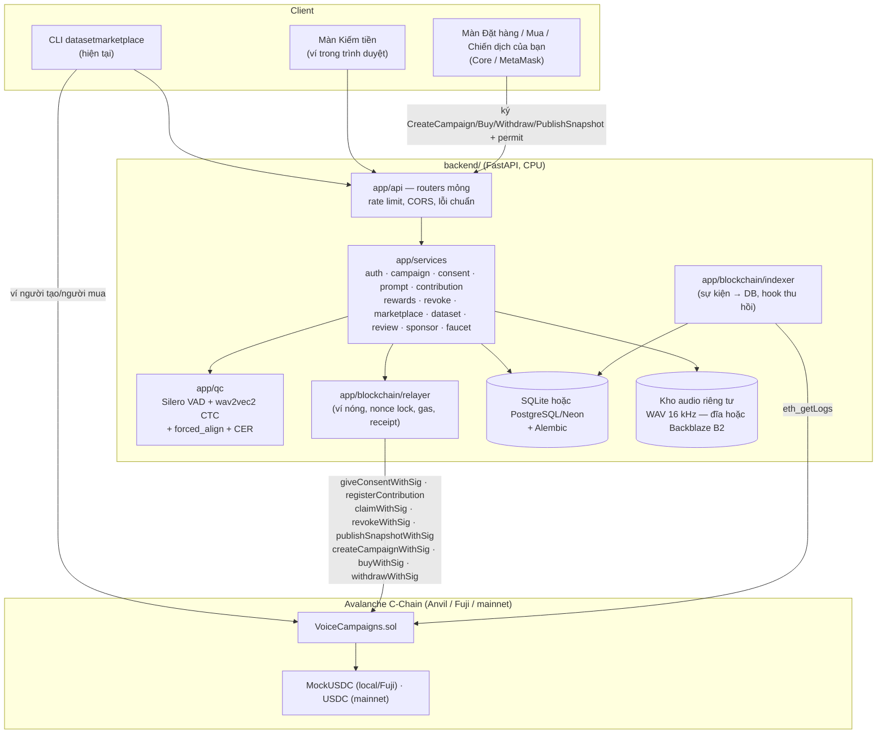
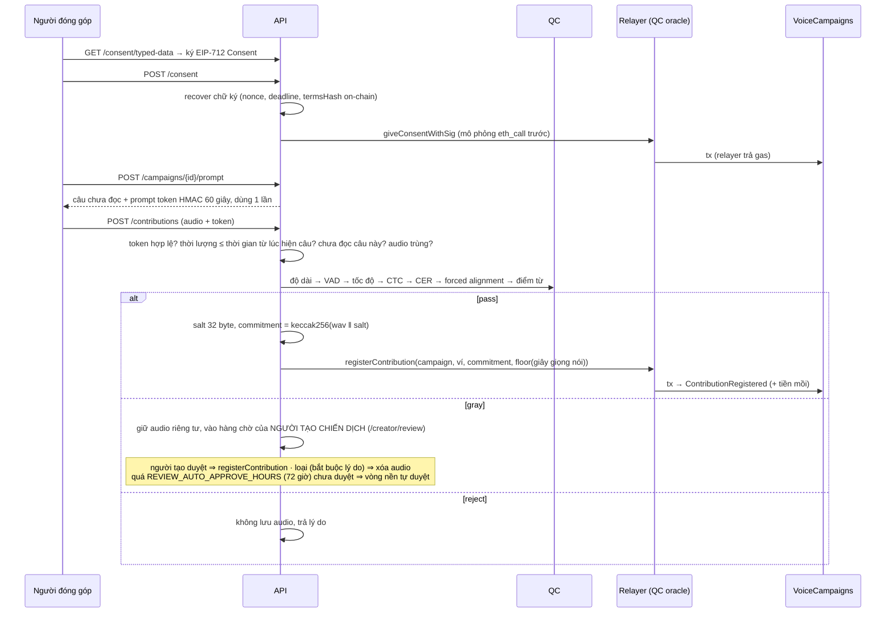

# Kiến trúc Dataset Marketplace

> Nguyên tắc (đề xuất §4): **chain giữ tiền, quyền và bằng chứng; server giữ dữ liệu.** Audio và thông tin cá nhân
> không bao giờ lên chain.

## Luồng đóng góp (đề xuất §6.4)

## Thu hồi (đề xuất §6.8)
`POST /revoke` (chữ ký `Revoke`) **hoặc** người dùng tự gọi `revoke()` → sự kiện `ConsentRevoked` → indexer gọi
`DatasetService.purge_revoked`: xóa file audio, xóa salt + sha256, đánh dấu mọi phiên bản dataset chứa bản ghi là
`stale` (link tải cũ trả 410). Backend **không** tự công bố phiên bản mới: người tạo chiến dịch xem bản tóm tắt
(`GET /campaigns/{id}/snapshot-quote`) rồi ký `PublishSnapshot`; relayer gọi `publishSnapshotWithSig` (contract chỉ
nhận chữ ký của đúng người tạo — implementation-plan §3 #28).

## Không có vai trò quản trị (implementation-plan §3 #28)
Dữ liệu của chiến dịch thuộc người tạo chiến dịch: chỉ họ nghe/duyệt bản ghi vùng xám và ký công bố phiên bản dataset
("Chiến dịch của bạn" ở `/create`, hoặc CLI `review …`, `dataset snapshot --as <người tạo>`). Nền tảng chỉ chạy việc nền
trong backend (`main.py`, cùng vòng indexer): đồng bộ sự kiện, `ReviewService.auto_approve_overdue` (tự duyệt quá hạn),
`ReviewService.retry_pending_chain` (thử ghi lại bản ghi lỗi tạm thời sau 10 phút).

## Dữ liệu theo deployment
Mỗi deployment có dấu vân tay = sha256(chainId, địa chỉ contract, hash block deploy).

- **Audio**: mặc định ở `storage/<network>-<fingerprint>/audio/` trên máy backend; đặt `B2_KEY_ID` + `B2_APPLICATION_KEY` +
  `B2_BUCKET` thì lưu trên **Backblaze B2** (bucket riêng tư, SSE-B2, tên file `<network>-<fingerprint>/audio/...`;
  implementation-plan §3 #29). Database chỉ lưu đường dẫn tương đối `audio/<chiến dịch>/<uuid>.wav`.
- Dùng **Neon + Backblaze B2** thì backend không ghi gì xuống đĩa (không tạo `storage/`). Trạng thái Anvil khi chạy
  `start-anvil persist` là dữ liệu của chain local, nằm ở `contracts/.anvil/anvil-state.json` (gitignore), không lên cloud.
- **SQLite** (mặc định): file `datasetmarketplace.db` trong cùng thư mục ⇒ Anvil khởi động lại tự sang thư mục/database mới.
- **PostgreSQL/Neon** (`DATABASE_URL`, tùy chọn `DATABASE_SCHEMA`): một database dùng chung, được **đóng dấu** dấu vân tay
  (bảng `kv_state`, khóa `deployment.fingerprint`). Dấu không khớp chain hiện tại ⇒ backend từ chối khởi động thay vì trộn
  dữ liệu hai chain (trùng campaignId, sai block của indexer, metadata không liên kết được).
- **Reset**: `scripts\reset-db.bat` / `reset-local.bat` (`backend/scripts/reset_db.py`) xóa bảng database **và** thư mục audio
  (cả file trên B2 có tiền tố `<network>-` khi bật B2) cùng lúc; mainnet luôn từ chối, Fuji cần `--allow-fuji`. Blockchain không bị đụng tới: lần khởi động sau, backend tạo lại
  bảng, nạp seed và đọc lại sự kiện từ chain.
## Bảo mật
| Mối đe dọa | Biện pháp |
|---|---|
| Phát lại chữ ký | Nonce on-chain (OZ `Nonces`) + deadline ≤ 1 ngày; chữ ký đăng nhập dùng challenge một lần; chữ ký tải dataset có nonce + lưu hash đã dùng |
| Chữ ký sai | Backend recover trước khi gửi; relayer mô phỏng `eth_call` (không tốn gas nếu revert) |
| Audio chuẩn bị sẵn / TTS | Câu chỉ hiện khi xin; prompt token 60 giây, 1 lần; audio không được dài hơn thời gian từ lúc hiện câu; chọn câu cụ thể chỉ có ở local+dev |
| Trùng bản ghi | Một người không đọc lại câu; sha256 audio chuẩn hóa không trùng; commitment khóa vĩnh viễn on-chain |
| Tải trái phép | Chữ ký EIP-191 chứng minh ví + `licenses()` on-chain; link HMAC 10 phút; kiểm tra lại license khi tải |
| Nhầm môi trường | `DEV_AUTH_ENABLED` ngoài local ⇒ không khởi động; mainnet: không mount faucet/dev login, từ chối token `mUSDC`, bắt buộc `FX_URL`; Deploy/SeedDemo chặn theo chain id |
| Lộ bí mật | Khóa trong biến môi trường; `RedactFilter` che salt/khóa trong log; `.env` thật bị gitignore; khóa B2 không có trong `repr`/log, chỉ cấp cho một bucket |
| Quyết định dữ liệu thay chủ | Không có endpoint quản trị; duyệt vùng xám cần phiên của đúng ví người tạo; công bố phiên bản cần chữ ký EIP-712 của người tạo (contract kiểm `NotCreator` / `BadSignature`) |
| Spam | Rate limit theo user (JWT đã xác minh) hoặc IP |
