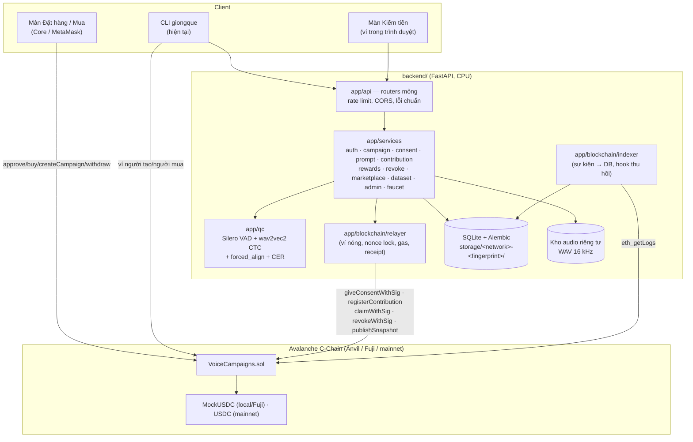
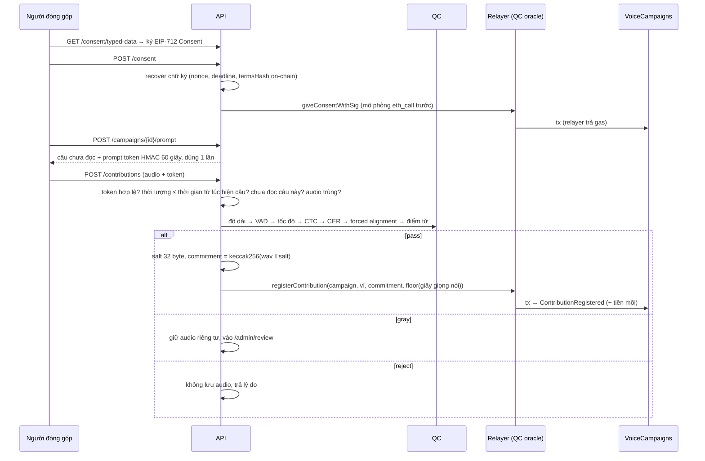

# Kiến trúc Dataset Marketplace

> Nguyên tắc (đề xuất §4): **chain giữ tiền, quyền và bằng chứng; server giữ dữ liệu.** Audio và thông tin cá nhân
> không bao giờ lên chain.

## Luồng đóng góp (đề xuất §6.4)

## Thu hồi (đề xuất §6.8)
`POST /revoke` (chữ ký `Revoke`) **hoặc** người dùng tự gọi `revoke()` → sự kiện `ConsentRevoked` → indexer gọi
`DatasetService.purge_revoked`: xóa file audio, xóa salt + sha256, đánh dấu mọi phiên bản dataset chứa bản ghi là
`stale` (link tải cũ trả 410), tự công bố phiên bản mới (Merkle root mới on-chain).

## Dữ liệu theo deployment
Thư mục dữ liệu = `storage/<network>-<fingerprint>`, fingerprint = sha256(chainId, địa chỉ contract, hash block
deploy). Khởi động lại Anvil (chain mới, có thể trùng địa chỉ contract) ⇒ DB mới, không lẫn dữ liệu cũ.

## Bảo mật
| Mối đe dọa | Biện pháp |
|---|---|
| Phát lại chữ ký | Nonce on-chain (OZ `Nonces`) + deadline ≤ 1 ngày; chữ ký đăng nhập dùng challenge một lần; chữ ký tải dataset có nonce + lưu hash đã dùng |
| Chữ ký sai | Backend recover trước khi gửi; relayer mô phỏng `eth_call` (không tốn gas nếu revert) |
| Audio chuẩn bị sẵn / TTS | Câu chỉ hiện khi xin; prompt token 60 giây, 1 lần; audio không được dài hơn thời gian từ lúc hiện câu; chọn câu cụ thể chỉ có ở local+dev |
| Trùng bản ghi | Một người không đọc lại câu; sha256 audio chuẩn hóa không trùng; commitment khóa vĩnh viễn on-chain |
| Tải trái phép | Chữ ký EIP-191 chứng minh ví + `licenses()` on-chain; link HMAC 10 phút; kiểm tra lại license khi tải |
| Nhầm môi trường | `DEV_AUTH_ENABLED` ngoài local ⇒ không khởi động; mainnet: không mount faucet/dev login, từ chối token `mUSDC`, bắt buộc `FX_URL`; Deploy/SeedDemo chặn theo chain id |
| Lộ bí mật | Khóa trong biến môi trường; `RedactFilter` che salt/khóa trong log; `.env` thật bị gitignore |
| Spam | Rate limit theo user (JWT đã xác minh) hoặc IP |
